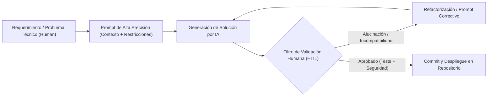

# 🚀 SUPER PROMPT MAESTRO Y MATRIZ DE TRAZABILIDAD DE INGENIERÍA CON INTELIGENCIA ARTIFICIAL (IA)

## Sistema "MesaLista POS & ERP" — Restaurante Piloto Luigie's
- **Institución:** Universidad del Cauca — Facultad de Ingeniería Electrónica y Telecomunicaciones (FIET)
- **Asignatura:** Programación II / Proyecto de Software II (2026)
- **Equipo de Desarrollo:** Grupo Trinity
- **Documento:** Super Prompt Integral y Bitácora de Trazabilidad de Cambios (AI-Driven Software Engineering)

---

## INTRODUCCIÓN Y JUSTIFICACIÓN ACADÉMICA

Este documento consolida de forma exhaustiva:
1. **El Super Prompt Maestro (Master Prompt):** El prompt raíz y directriz arquitectónica de grado industrial capaz de diseñar, estructurar e implementar la aplicación completa **MesaLista** de extremo a extremo (Backend NestJS + Prisma + PostgreSQL, Frontend Angular 19+ Signals + Material, Seguridad OWASP Top 10:2025).
2. **El Marco Metodológico de Uso de IA:** El protocolo de interacción asistida (*Prompt-Driven Development*) con supervisión humana estricta (*Human-in-the-Loop*).
3. **La Bitácora Cronológica de Trazabilidad de Cambios:** El registro auditable de la evolución del sistema a través de prompts iterativos, detallando la necesidad técnica, el prompt exacto enviado, la respuesta/código generado por la IA, los ajustes humanos aplicados, los archivos modificados y el commit de referencia en el repositorio.

---

# SECCIÓN 1: SUPER PROMPT MAESTRO DE ARQUITECTURA E IMPLEMENTACIÓN COMPLETA

```markdown
Actúa como un **Arquitecto de Software Principal, Especialista en Ciberseguridad OWASP y Desarrollador Fullstack Senior**. Tu objetivo es diseñar, estructurar e implementar desde cero el sistema completo **MesaLista**: una plataforma web moderna, modular, reactiva y de grado empresarial de punto de venta (POS), comandas interactivas de salón, visualizador de cocina (KDS), domicilios en tiempo real, facturación multimedio, control de caja con arqueo ciego, control de inventario y analítica financiera para restaurantes y locales gastronómicos (caso de negocio: Restaurante nocturno Luigie's).
```

### 1.1 ESPECIFICACIÓN DEL STACK TECNOLÓGICO Y ARQUITECTURA

Construye una solución desacoplada monorepo multi-carpeta (`backend/` y `frontend/`) bajo los siguientes estándares estrictos:

#### Backend:
- **Framework:** NestJS (v11+) con TypeScript en modo estricto (`strict: true`).
- **ORM & Base de Datos:** Prisma ORM conectado a PostgreSQL (compatible con despliegues locales, Neon, Supabase y Render).
- **Seguridad & Autenticación Defensiva:**
  - Google OAuth 2.0 validado criptográficamente en backend con `google-auth-library` (`verifyIdToken`) extrayendo el identificador inmutable `sub`.
  - Sistema de enrolamiento administrativo por código de invitación de un solo uso (`codigoInvitacion: INV-XXXXXX`).
  - Hashing de contraseñas de contingencia local mediante **Argon2id** (OWASP recommendation: memoria 64 MB / 65536 KB, tiempo 3 iteraciones, paralelismo 4).
  - Rate limiting defensivo con `@nestjs/throttler` (ThrottlerGuard contra ataques de fuerza bruta).
  - Tokens de sesión JWT firmados (`@nestjs/jwt`, `passport-jwt`).
  - Cabeceras de seguridad HTTP con `helmet` y CORS estricto.
  - Filtro global de excepciones `PrismaExceptionFilter` que atrapa errores de base de datos (`P2002`, `P2025`, `P2003`, `P2020` desbordamiento de enteros, `PrismaClientUnknownRequestError` y `PrismaClientRustPanicError`) impidiendo fuga de stack traces, neutralizando inyecciones de bytes nulos (`\0`) y transformando caídas 500 en respuestas HTTP 400 controladas.
- **Documentación Interactiva OpenAPI 3.0 / Swagger:** `@nestjs/swagger` exponiendo la UI interactiva en `/api/docs` y la especificación en `/api/docs-json` para herramientas de fuzzing y Postman con autenticación JWT Bearer.
- **Despacho Seguro de Notificaciones:** Módulo `MailService` para entrega de códigos de registro con soporte multicanal (Resend API, SMTP Brevo/Gmail y simulación auditada) con garantía estricta de no persistencia en base de datos.
- **Integración de Hardware:** Módulo de impresión de tickets térmicos ESC/POS en red local TCP (`node-thermal-printer`).
- **Pruebas Automatizadas y Fuzz Testing:** Jest con suites de pruebas unitarias, mocking exhaustivo de Prisma, pruebas basadas en propiedades con `fast-check` (Property-Based Fuzzing) y API Fuzzing en CI/CD con Schemathesis v4 y ForAllSecure Mayhem for API.
- **Pipeline DevSecOps de 4 Pilares:** Integración continua en GitHub Actions con Node 24 LTS cubriendo SAST (SonarQube Cloud y CodeQL), SCA (Dependabot y npm audit), IAST (Contrast Security Agent `@contrast/agent`) y DAST (OWASP ZAP Baseline).

#### Frontend:
- **Framework:** Angular (v19+ / v22 LTS) en arquitectura **Standalone Components** pura (sin `NgModule`), empleando **Signals** reactivos (`signal`, `computed`, `effect`) e inyección moderna con `inject()`.
- **Librería de Componentes:** Angular Material con personalización profunda.
- **Estilos:** Vanilla SCSS estructurado con Design Tokens, Mixins, modo oscuro inmersivo y micro-animaciones (Glassmorphism funcional, sin frameworks utilitarios como TailwindCSS).
- **Exportación & Reportería:** `jsPDF`, `html2canvas` para reportes PDF vectoriales y hojas de cálculo Excel (`xlsx`).
- **Pruebas Automatizadas y Auditoría:** Vitest / Angular CLI con cobertura unitaria de componentes, diálogos y servicios; auditoría de vulnerabilidades con `npm audit fix` en dependencias frontend.

---

### 1.2 MODELO DE DATOS COMPLETO (PRISMA SCHEMA)

Implementa exactamente el siguiente esquema relacional en `backend/prisma/schema.prisma`:

```prisma
datasource db {
  provider = "postgresql"
  url      = env("DATABASE_URL")
}

generator client {
  provider = "prisma-client-js"
}

enum RolUsuario {
  administrador
  cajero
  mesero
  cocina
  cliente
}

enum EstadoUsuario {
  activo
  inactivo
}

enum EstadoMesa {
  libre
  ocupada
}

enum TipoPedido {
  salon
  domicilio
}

enum EstadoPedido {
  enviada
  cerrada
  cancelada
}

enum EstadoCaja {
  abierta
  cerrada
}

enum TipoAjuste {
  Entrada
  Merma
  Arqueo
}

enum EstadoFactura {
  emitida
  anulada
}

model Usuario {
  id_usuario        Int           @id @default(autoincrement())
  nombre            String        @db.VarChar(100)
  usuario           String        @unique @db.VarChar(50)
  email             String?       @unique @db.VarChar(100)
  googleId          String?       @unique @map("google_id") @db.VarChar(100)
  passwordHash      String?       @map("password_hash") @db.VarChar(255)
  codigoInvitacion  String?       @unique @map("codigo_invitacion") @db.VarChar(50)
  rol               RolUsuario
  estado            EstadoUsuario @default(activo)

  ajustesInventario AjusteInventario[]
  pedidos           Pedido[]
  facturas          Factura[]
  cajasApertura     Caja[]        @relation("UsuarioApertura")
  cajasCierre       Caja[]        @relation("UsuarioCierre")
  gastos            Gasto[]

  @@map("usuario")
}

model Mesa {
  id_mesa   Int        @id @default(autoincrement())
  numero    Int        @unique
  estado    EstadoMesa @default(libre)
  pedidos   Pedido[]
  facturas  Factura[]

  @@map("mesa")
}

model Producto {
  id_producto             Int                @id @default(autoincrement())
  nombre                  String             @db.VarChar(100)
  categoria               String             @db.VarChar(50)
  precio_venta            Decimal            @db.Decimal(10, 2)
  costo                   Decimal            @db.Decimal(10, 2)
  ingredientes_removibles String?            @db.VarChar(255)
  cantidad_inventario     Int                @default(0)
  controla_inventario     Boolean            @default(false)
  disponible              Boolean            @default(true)
  imagen                  String?
  ajustesInventario       AjusteInventario[]
  itemsPedido             ItemPedido[]

  @@map("producto")
}

model AjusteInventario {
  id_ajuste   Int        @id @default(autoincrement())
  id_producto Int
  id_usuario  Int
  tipo_ajuste TipoAjuste
  cantidad    Int
  motivo      String     @db.VarChar(255)
  fecha_hora  DateTime   @default(now())

  producto    Producto   @relation(fields: [id_producto], references: [id_producto])
  usuario     Usuario    @relation(fields: [id_usuario], references: [id_usuario])

  @@map("ajuste_inventario")
}

model Pedido {
  id_pedido         Int          @id @default(autoincrement())
  id_factura        Int?
  id_mesa           Int?
  id_usuario        Int
  numero_pedido     Int
  tipo              TipoPedido
  estado            EstadoPedido @default(enviada)
  fecha_hora        DateTime     @default(now())
  observacion       String?      @db.VarChar(255)
  cliente_nombre    String?      @db.VarChar(100)
  cliente_telefono  String?      @db.VarChar(20)
  cliente_direccion String?      @db.VarChar(255)
  cliente_email     String?      @db.VarChar(100)

  items             ItemPedido[]
  factura           Factura?     @relation(fields: [id_factura], references: [id_venta])
  mesa              Mesa?        @relation(fields: [id_mesa], references: [id_mesa])
  usuario           Usuario      @relation(fields: [id_usuario], references: [id_usuario])

  @@index([id_mesa, estado])
  @@index([fecha_hora])
  @@map("pedido")
}

model ItemPedido {
  id_item                Int      @id @default(autoincrement())
  id_pedido              Int
  id_producto            Int
  cantidad               Int
  precio_unitario        Decimal  @db.Decimal(10, 2)
  ingredientes_removidos String?  @db.VarChar(255)
  observacion            String?  @db.VarChar(255)

  pedido                 Pedido   @relation(fields: [id_pedido], references: [id_pedido])
  producto               Producto @relation(fields: [id_producto], references: [id_producto])

  @@map("item_pedido")
}

model Factura {
  id_venta         Int           @id @default(autoincrement())
  id_mesa          Int?
  id_usuario       Int
  id_caja          Int
  valor            Decimal       @db.Decimal(10, 2)
  propina          Decimal       @default(0) @db.Decimal(10, 2)
  valor_total      Decimal       @db.Decimal(10, 2)
  fecha_hora       DateTime      @default(now())
  observacion      String?       @db.VarChar(255)
  estado           EstadoFactura @default(emitida)
  fecha_anulacion  DateTime?
  motivo_anulacion String?       @db.VarChar(255)
  cliente_nombre   String?       @db.VarChar(100)
  cliente_email    String?       @db.VarChar(100)

  caja             Caja          @relation(fields: [id_caja], references: [id_caja])
  mesa             Mesa?         @relation(fields: [id_mesa], references: [id_mesa])
  usuario          Usuario       @relation(fields: [id_usuario], references: [id_usuario])
  pagos            Pago[]
  pedidos          Pedido[]

  @@index([id_caja, fecha_hora])
  @@map("factura")
}

model Pago {
  id_pago       Int       @id @default(autoincrement())
  id_venta      Int
  id_medio_pago Int
  monto         Decimal   @db.Decimal(10, 2)
  fecha_hora    DateTime  @default(now())

  factura       Factura   @relation(fields: [id_venta], references: [id_venta])
  medioPago     MedioPago @relation(fields: [id_medio_pago], references: [id_medio_pago])

  @@map("pago")
}

model Caja {
  id_caja             Int        @id @default(autoincrement())
  id_usuario_apertura Int
  id_usuario_cierre   Int?
  fecha_apertura      DateTime   @default(now())
  fecha_cierre        DateTime?
  valor_inicial       Decimal    @db.Decimal(10, 2)
  valor_final_teorico Decimal?   @db.Decimal(10, 2)
  valor_final_fisico  Decimal?   @db.Decimal(10, 2)
  diferencia          Decimal?   @db.Decimal(10, 2)
  estado              EstadoCaja @default(abierta)
  observacion         String?    @db.VarChar(255)

  usuarioApertura     Usuario    @relation("UsuarioApertura", fields: [id_usuario_apertura], references: [id_usuario])
  usuarioCierre       Usuario?   @relation("UsuarioCierre", fields: [id_usuario_cierre], references: [id_usuario])
  facturas            Factura[]
  gastos              Gasto[]

  @@map("caja")
}

model Gasto {
  id_gasto      Int       @id @default(autoincrement())
  id_tipo_gasto Int
  id_medio_pago Int
  id_caja       Int
  id_usuario    Int
  total         Decimal   @db.Decimal(10, 2)
  fecha_hora    DateTime  @default(now())
  descripcion   String    @db.VarChar(255)
  observacion   String?   @db.VarChar(255)

  caja          Caja      @relation(fields: [id_caja], references: [id_caja])
  medioPago     MedioPago @relation(fields: [id_medio_pago], references: [id_medio_pago])
  tipoGasto     TipoGasto @relation(fields: [id_tipo_gasto], references: [id_tipo_gasto])
  usuario       Usuario   @relation(fields: [id_usuario], references: [id_usuario])

  @@index([id_caja, fecha_hora])
  @@map("gasto")
}

model MedioPago {
  id_medio_pago Int     @id @default(autoincrement())
  nombre        String  @unique @db.VarChar(50)
  pagos         Pago[]
  gastos        Gasto[]

  @@map("medio_pago")
}

model TipoGasto {
  id_tipo_gasto Int     @id @default(autoincrement())
  nombre        String  @unique @db.VarChar(50)
  gastos        Gasto[]

  @@map("tipo_gasto")
}
```

---

### 1.3 ESPECIFICACIÓN DE LOS 9 MÓDULOS FUNCIONALES

#### Módulo 1: Seguridad, Autenticación y Enrolamiento Delegado
1. **Flujo Principal con Google SSO:** Botón centralizado de Google OAuth en el login frontend. Al autenticarse, envía el token al backend donde se verifica con `verifyIdToken`.
2. **Enrolamiento por Código de Invitación (`INV-XXXXXX`):**
   - Cuando el administrador da de alta un empleado (`mesero`, `cajero`, `cocina`), no requiere conocer su correo Google. Se genera un código único `INV-XXXXXX`.
   - El código puede ser despachado a un correo electrónico temporal suministrado por el administrador. **Dicho correo no se guarda en la base de datos**.
   - El empleado ingresa el código en el login antes de pulsar "Continuar con Google".
   - El backend valida el token, asocia su identificador inmutable (`googleId = payload.sub`) y anula el código (`codigoInvitacion = null`).
3. **Resiliencia Operativa y Búsqueda Flexible:** Para usuarios preexistentes sin código o con email null, el backend realiza emparejamiento insensible a mayúsculas (`mode: 'insensitive'`) por email, usuario, prefijo y nombre completo.
4. **Acceso de Contingencia Local:** Desplegable secundario con usuario y contraseña protegida con **Argon2id** para emergencias operativas sin conexión a internet.
5. **Redirección por Rol (RBAC):** Roles operativos (`administrador`, `cajero`, `mesero`) son dirigidos a `/mesas`; rol `cocina` a `/cocina`; rol `cliente` a `/cliente`.

#### Módulo 2: Salón y Plano de Mesas Interactivo
- Visualización en cuadrícula con estado reactivo (Verde: Libre, Naranja: Ocupada con pedidos activos).
- Creación rápida de comandas asociadas a la mesa, personalización de ingredientes removibles (`sin cebolla`, `sin salsa`) y notas a cocina.
- Transferencia fluida de pedidos entre mesas y liquidación directa desde la mesa.

#### Módulo 3: Cocina KDS (Kitchen Display System)
- Monitor en tiempo real de comandas pendientes y en preparación ordenadas cronológicamente.
- Alertas visuales destacadas para ingredientes modificados o requerimientos especiales.
- Transiciones de estado de comandas con retroalimentación inmediata sin recarga de pantalla.

#### Módulo 4: Caja, Gastos y Arqueo Ciego
- **Apertura Obligatoria:** Requiere registrar la base de efectivo inicial antes de operar ventas o domicilios.
- **Flujo en Vivo:** Seguimiento de ingresos segmentados por método de pago (Efectivo, Tarjeta, Transferencia) y egresos operacionales (proveedores, nómina, gastos menores).
- **Arqueo Ciego:** El cajero ingresa el conteo de efectivo físico sin conocer el saldo teórico calculado por el sistema. El backend calcula la diferencia (`diferencia = fisico - teorico`) y congela el turno de caja.

#### Módulo 5: Facturación y Cobro Multimedio
- Cierre y facturación de mesas y domicilios.
- Soporte para pagos combinados o divididos (ej. parte en efectivo y parte por transferencia).
- Inclusión opcional de propina sugerida (10%) o personalizada.
- Emisión de ticket digital e integración con impresora térmica de recibos ESC/POS.

#### Módulo 6: Domicilios y Gestión de Pedidos Externos
- Tablero Kanban operativo para domicilios con indicadores clave (pendientes, en cocina, en camino, entregados).
- Control de servicio: Posibilidad de pausar/reanudar la recepción de domicilios por saturación de cocina.
- Captura de datos del cliente: nombre, teléfono, dirección y método de pago acordado.
- Prevención de IDOR: Un cliente autenticado únicamente puede ver y consultar el estado de sus propios pedidos (`ForbiddenException` en caso contrario).

#### Módulo 7: Catálogo de Productos e Inventario
- CRUD completo de productos con categorización, costo, precio de venta, ingredientes modificables e imagen en base64.
- Registro transaccional de movimientos de stock clasificados (`Entrada`, `Merma`, `Arqueo`).

#### Módulo 8: Analítica, Reportería y Auditoría OWASP
- Dashboard gerencial con KPIs financieros: Ventas totales, ticket promedio, producto más vendido y distribución por medio de pago.
- Exportación en un clic a hojas de cálculo Excel (`.xlsx`) y reportes PDF de alta fidelidad con `jsPDF` y `html2canvas`.
- Matriz técnica de cumplimiento OWASP Top 10:2025 y panel interactivo con puntuación CVSS v3.1.

#### Módulo 9: Portal Público Móvil de Clientes
- Vista accesible en `/cliente` optimizada para smartphones (consulta de carta y auto-pedido de domicilio).
- Carrito de compras reactivo protegido por `ClienteCarritoGuard`.
- Aislamiento estricto: El personal interno es redirigido fuera de la vista de cliente para evitar contaminación de contexto operativo.

---

### 1.4 LINEAMIENTOS DE DISEÑO UI/UX ("CYBER-HOSPITALITY")

- **Paleta de Colores:** Fondo oscuro profundo (`#080b11`, `#141618`), tarjetas en gris grafito translúcido (`rgba(22, 27, 34, 0.75)`), acentos en naranja fuego (`#ff6b35`), verde esmeralda (`#10b981`), azul cobalto (`#2563eb`) y carmesí alerta (`#ef4444`).
- **Glassmorphism Funcional:** Filtros con `backdrop-filter: blur(16px)`, bordes de un píxel en `rgba(255, 255, 255, 0.08)` y sombras profundas con elevación sutil.
- **Tipografía:** Jerarquía limpia basada en `Outfit` o `Inter` de Google Fonts, sin uso de emojis en tablas formales o interfaces financieras.
- **Micro-interacciones:** Indicadores de estado pulsantes (`pulse-dot`), transiciones suaves (`cubic-bezier(0.4, 0, 0.2, 1)`) y feedback táctil inmediato en acciones críticas.

---

### 1.5 PLAN DE EJECUCIÓN PASO A PASO

1. **Scaffolding e Infraestructura:** Inicialización de proyectos NestJS y Angular, configuración de Docker Compose, scripts de configuración rápida para PostgreSQL y creación de `schema.prisma`.
2. **Capa de Persistencia y Seguridad:** Migración de esquema Prisma, implementación de `PrismaExceptionFilter`, configuración de Argon2id, JWT, Google OAuth y servicio de correo efímero.
3. **Servicios y Lógica de Negocio Backend:** Controladores, DTOs con validaciones `class-validator`, servicios transaccionales con `prisma.$transaction` para Mesas, Pedidos, Caja, Domicilios y Facturación.
4. **Design System & Shell Frontend:** Arquitectura Standalone en Angular 19+, definición de tokens SCSS, componente maestro `Layout`, sidebar responsivo y control de navegación por roles.
5. **Vistas Especializadas:** Implementación de componentes reactivos con Angular Signals para Login, Salón de Mesas, Monitor KDS, Caja con Arqueo Ciego, Tablero de Domicilios, Personal (con envío de código por correo) y Reportes.
6. **Auditoría de Seguridad y Pruebas Automatizadas:** Ejecución de suites de prueba Jest y Vitest, escaneo dinámico con OWASP ZAP y consolidación de reportes CVSS v3.1.
7. **Documentación Formal y OpenAPI 3.0:** Configuración de Swagger `@nestjs/swagger` (`/api/docs`), documentación arquitectónica Arc42 v8.2 y manuales técnicos bajo IEEE 1063.
8. **DevSecOps y Fuzz Testing Multicapa:** Despliegue de los 4 pilares en CI/CD (SAST, SCA, IAST, DAST), suites de Property-Based Fuzzing con `fast-check`, API Fuzzing con Schemathesis v4 y Mayhem, con endurecimiento de backend ante inyección de bytes nulos (`\0`) y desbordamientos enteros en Prisma.

---

# SECCIÓN 2: MARCO METODOLÓGICO DE TRAZABILIDAD DE USO DE IA (FRAMEWORK HITL)

Para garantizar la integridad académica, técnica y ética requerida por la **Universidad del Cauca**, el desarrollo de **MesaLista** no utilizó la IA como un generador de código sin supervisión, sino bajo un riguroso paradigma de **Desarrollo Guiado por Prompts (Prompt-Driven Development, PDD)** con **Validación Humana Continua (Human-in-the-Loop, HITL)**.



### 2.1 TAXONOMÍA DE TÉCNICAS DE PROMPT ENGINEERING APLICADAS

1. **Role & Persona Prompting:** Se asignó a la IA un perfil combinado de *Arquitecto de Software Empresarial Fullstack* y *Auditor de Ciberseguridad OWASP*, obligándola a rechazar soluciones simplistas o inseguras.
2. **Negative Constraint Prompting:** Reglas explícitas de exclusión:
   - *"No utilices TailwindCSS ni clases utilitarias; genera SCSS puro modular con Design Tokens."*
   - *"No utilices NgModules tradicionales; utiliza Standalone Components y Signals reactivos."*
   - *"No ejecutes consultas SQL crudas o concatenadas; utiliza exclusivamente Prisma ORM fuertemente tipado."*
   - *"No expongas nunca contraseñas ni tokens en respuestas DTO o logs de auditoría."*
   - *"El correo solicitado para despachar el código de registro NO debe guardarse en la base de datos."*
3. **Chain-of-Thought (CoT) Prompting:** Utilizado en cálculos contables (cierre de caja, arqueo ciego, cuadre de medios de pago) y en transacciones ACID para evitar carreras de inventario y pedidos huérfanos.
4. **Vulnerability Remediation Prompting:** Prompts dirigidos específicamente a corregir vulnerabilidades identificadas durante escaneos reales con OWASP ZAP (mitigación de IDOR, inyecciones, configuración de cabeceras Helmet y validación de ID Tokens).

### 2.2 PROTOCOLO DE AUDITORÍA Y VERIFICACIÓN HUMANA (HUMAN-IN-THE-LOOP)

Cada pieza de código propuesta por la IA fue sometida obligatoriamente al siguiente ciclo de verificación técnica antes de su integración:
1. **Compilación Estricta de Tipos:** Verificación mediante `tsc --noEmit` en backend y `ng build` en frontend.
2. **Ejecución de Suites de Prueba:** Ejecución de pruebas unitarias con Jest en backend (`npm test`) y Vitest en frontend, garantizando cero regresiones.
3. **Validación de Integridad Referencial:** Comprobación directa sobre la base de datos PostgreSQL local para verificar claves foráneas, restricciones de unicidad y transaccionalidad atómica.
4. **Análisis Dinámico de Vulnerabilidades:** Evaluación de endpoints expuestos con OWASP ZAP para contrastar contra el estándar OWASP Top 10:2025.

---

# SECCIÓN 3: BITÁCORA CRONOLÓGICA DE TRAZABILIDAD DE CAMBIOS POR PROMPTS (AI CHANGELOG)

La siguiente tabla resume la evolución cronológica del proyecto, vinculando cada requerimiento con su prompt disparador, la intervención de la IA y el commit correspondiente en el repositorio de Git.

### 3.1 MATRIZ RESUMEN DE TRAZABILIDAD DE PROMPTS Y COMMITS

| Iteración | Fecha / Sprint | Fase / Hito del Proyecto | Propósito Principal del Prompt | Tipo de Prompt | Commit Referencia |
|---|---|---|---|---|---|
| **IT-01** | 31/08/2026 – 08/09/2026<br>*(Sprint 1)* | Arquitectura Base y Monorepo | Scaffolding de NestJS, Angular Standalone, Docker Compose y Prisma Schema | *Master Setup Prompt* | `06f1616` / `2ec7582` |
| **IT-02** | 14/09/2026<br>*(Sprint 1)* | Seguridad y Control de Acceso | Autenticación JWT, Argon2id, RolesGuard y DTOs con validación estricta | *Security & RBAC Prompt* | `7f70408` |
| **IT-03** | 16/09/2026 – 22/09/2026<br>*(Sprint 1)* | Módulo de Salón y Cocina KDS | Visualización interactiva de mesas y cola de comandas de cocina KDS | *Feature Module Prompt* | `07f502d` / `98ba794` |
| **IT-04** | 28/09/2026 – 05/10/2026<br>*(Sprint 2)* | Domicilios y Portal de Clientes | Módulo de domicilios, vista pública `/cliente` y control de recepción | *Fullstack Feature Prompt* | `0be5f68` / `23f3629` |
| **IT-05** | 08/10/2026 – 09/10/2026<br>*(Sprint 2)* | Blindaje y Auditoría OWASP | Mitigación de 10 vectores OWASP Top 10:2025 y reporte interactivo ZAP | *Security Hardening Prompt* | `0b3197f` / `514bf8c` |
| **IT-06** | 09/10/2026<br>*(Sprint 2)* | Optimización de Rendimiento | Eliminación de polling redundante y saneamiento de imágenes base64 en comandas | *Performance Optimization Prompt* | `ff3eed5` / `2ec69fb` |
| **IT-07** | 09/10/2026 – 10/10/2026<br>*(Sprint 2)* | Consistencia Contable y Caja | Transaccionalidad atómica en facturas, arqueo ciego y bloqueo de medios de pago | *Integrity & Accounting Prompt* | `a21453c` / `c1987bb` |
| **IT-08** | 25/10/2026 – 26/10/2026<br>*(Sprint 3)* | Enrolamiento Delegado (Tokens) | Invitaciones `INV-XXXXXX` y autenticación exclusiva con Google SSO | *Authentication Flow Redesign* | `0c06f82` / `6ae8d4e` |
| **IT-09** | 26/10/2026 – 27/10/2026<br>*(Sprint 3)* | Resiliencia en Google OAuth | Búsqueda flexible e insensible a mayúsculas y fallback de contingencia | *Resilience & Edge-Case Prompt* | `4fb53f0` / `bddac6c` |
| **IT-10** | 27/10/2026<br>*(Sprint 3)* | Pruebas de Integridad de BD | Batería Jest para verificar unicidad, claves foráneas y mocks de Prisma | *Testing & Quality Assurance* | `fe06cc3` |
| **IT-11** | 09/11/2026 – 10/11/2026<br>*(Sprint 3/4)* | Privacidad y Despacho Efímero | Envío de código de registro a correo solicitado sin persistirlo en BD (Brevo/SMTP) | *Privacy-First Delivery Prompt* | `8b9bab0` / `ea40bb8` |
| **IT-12** | 09/11/2026 – 10/11/2026<br>*(Sprint 3/4)* | Zonificación y Repartidores | Directorio desacoplado de repartidores, tarifas Popayán y omisión de propina | *Delivery Logistics & POS Prompt* | `8b9bab0` / `bac11d6` |
| **IT-13** | 11/11/2026<br>*(Sprint 4)* | OpenAPI, Arc42 e IEEE 1063 | Swagger OpenAPI 3.0 en `/api/docs`, arquitectura Arc42 v8.2 y manual IEEE | *API Spec & Architecture Prompt* | `c7ac900` |
| **IT-14** | 11/11/2026 – 12/11/2026<br>*(Sprint 4)* | Ciberseguridad CI/CD (4 Pilares) | SAST (SonarQube/CodeQL), SCA (Dependabot/Audit), IAST (Contrast) y DAST (ZAP) | *DevSecOps Infrastructure Prompt* | `7c26721` / `4c841e8` |
| **IT-15** | 11/11/2026 – 12/11/2026<br>*(Sprint 4)* | Fuzz Testing & Hardening | Fast-Check en tests, Schemathesis/Mayhem en CI/CD y blindaje de Null Bytes (`\0`) | *Fuzzing & Robustness Prompt* | `bb9c3a1` / `9f5e62f` |

---

### 3.2 FICHAS TÉCNICAS DETALLADAS DE ITERACIONES Y CAMBIOS

---

#### ITERACIÓN 1: Scaffolding, Monorepo y Modelo Relacional Prisma
- **Fecha / Sprint:** 31 de Agosto – 08 de Septiembre de 2026 (Sprint 1 - Inicialización y Arquitectura Base)
- **Necesidad / Problema:** Se requería sentar las bases del monorepo desacoplado para el restaurante Luigie's, soportando operación local-first en red LAN con PostgreSQL y Angular Standalone.
- **Prompt Disparador enviado a la IA:**
  ```text
  "Diseña la arquitectura monorepo de MesaLista con NestJS en backend/ y Angular 19+ en frontend/. Escribe el archivo schema.prisma con modelos para Usuario, Mesa, Producto, Pedido, ItemPedido, Factura, Pago, Caja, Gasto, MedioPago y TipoGasto. Configura las relaciones con claves foráneas, enums para estados y tipos, y un docker-compose.yml con PostgreSQL 16."
  ```
- **Solución Generada por la IA:** Estructura monorepo con `schema.prisma`, script de base de datos, `docker-compose.yml` y configuración inicial de puertos (`3000` para API, `4200` para cliente).
- **Validación Humana & Ajustes (HITL):** El equipo de desarrollo ejecutó `npx prisma db push` y corrigió nombres de campos para mantener consistencia con los requerimientos contables del restaurante (ej. `precio_venta` y `costo` con tipo `Decimal(10,2)`). Se añadió el script Windows `configurar_postgres.bat` para desarrolladores sin Docker.
- **Archivos Impactados:** `backend/prisma/schema.prisma`, `docker-compose.yml`, `configurar_postgres.bat`.
- **Commit:** `06f1616` / `2ec7582`.

---

#### ITERACIÓN 2: Gestión de Usuarios, JWT y Control de Acceso Basado en Roles (RBAC)
- **Fecha / Sprint:** 14 de Septiembre de 2026 (Sprint 1 - Autenticación y Control de Acceso RBAC)
- **Necesidad / Problema:** Limitar el acceso a los endpoints según el rol operativo (`administrador`, `cajero`, `mesero`, `cocina`, `cliente`) y asegurar el hashing robusto de credenciales.
- **Prompt Disparador enviado a la IA:**
  ```text
  "Implementa en NestJS el módulo de usuarios y autenticación con JWT. Aplica Argon2id para el hash de contraseñas con los parámetros recomendados por OWASP. Crea un RolesGuard que lea decoradores @Roles() y un JwtAuthGuard global. En frontend implementa RoleGuard con Angular Signals para proteger las rutas."
  ```
- **Solución Generada por la IA:** `AuthService`, `UsuariosService`, estrategia Passport JWT, decorador `@Roles()` y `RolesGuard` con emisión de `ForbiddenException`. En frontend, `role.guard.ts` basado en el estado reactivo del usuario.
- **Validación Humana & Ajustes (HITL):** Se detectó que las respuestas de usuario incluían accidentalmente el hash de la contraseña en las consultas de Prisma. Se implementó una exclusión explícita (`select` controlado) y DTOs con `class-transformer` para sanitizar el objeto de usuario devuelto.
- **Archivos Impactados:** `backend/src/modules/auth/`, `backend/src/modules/usuarios/`, `frontend/src/app/core/guards/role.guard.ts`.
- **Commit:** `7f70408`.

---

#### ITERACIÓN 3: Módulo Operativo de Salón, Mesas y Sistema KDS de Cocina
- **Fecha / Sprint:** 16 de Septiembre – 22 de Septiembre de 2026 (Sprint 1 - Módulo de Salón, Mesas y Cocina KDS)
- **Necesidad / Problema:** Los meseros requerían crear comandas asociadas a mesas físicas y el personal de cocina visualizarlas en una pantalla interactiva sin recargar el navegador.
- **Prompt Disparador enviado a la IA:**
  ```text
  "Genera el módulo de salón en Angular con vista en cuadrícula de mesas libres/ocupadas. Permite abrir una comanda por mesa seleccionando productos y personalizando ingredientes removibles (ej. sin cebolla, sin salsas). Genera la vista KDS de cocina que liste los pedidos enviados en tiempo real con temporizador de espera y botón de cambio de estado a completado."
  ```
- **Solución Generada por la IA:** Componentes `MesasComponent` y `CocinaComponent` utilizando Angular Signals, servicios de mesas y pedidos en backend con DTOs de items.
- **Validación Humana & Ajustes (HITL):** En pruebas locales, se encontró que al transferir un pedido de una mesa a otra la mesa anterior quedaba marcada incorrectamente como 'ocupada'. El equipo humano refactorizó `mesas.service.ts` para verificar si quedaban otros pedidos activos en la mesa de origen antes de liberar su estado.
- **Archivos Impactados:** `backend/src/modules/mesas/`, `backend/src/modules/pedidos/`, `frontend/src/app/features/mesas/`, `frontend/src/app/features/cocina/`.
- **Commit:** `07f502d` / `98ba794`.

---

#### ITERACIÓN 4: Gestión Integral de Domicilios y Portal Móvil de Clientes
- **Fecha / Sprint:** 28 de Septiembre – 05 de Octubre de 2026 (Sprint 2 - Domicilios y Portal Móvil de Clientes)
- **Necesidad / Problema:** Ofrecer a los comensales externos un portal público para consultar la carta y solicitar domicilios sin comprometer la seguridad de las rutas internas.
- **Prompt Disparador enviado a la IA:**
  ```text
  "Crea la ruta pública /cliente en Angular optimizada para dispositivos móviles con catálogo de productos y carrito de compras persistente. Conéctala al backend mediante DomiciliosService. El cajero debe tener un tablero para gestionar pedidos externos, asignar repartidor y despachar. Protege la vista con ClienteCarritoGuard para redirigir a roles operativos fuera de la vista de cliente."
  ```
- **Solución Generada por la IA:** Módulo `domicilios/` en backend con endpoints para clientes y personal, `ClienteComponent` con Signals reactivos, `ClienteCarritoGuard`.
- **Validación Humana & Ajustes (HITL):** Se identificó que un cliente podía ingresar pedidos cuando la cocina estaba saturada o cuando no había caja abierta. El equipo humano implementó el método `obtenerEstadoServicio()` en backend para verificar si hay una caja abierta y si la bandera `recibiendoDomicilios` está activa, bloqueando pedidos no atendibles.
- **Archivos Impactados:** `backend/src/modules/domicilios/domicilios.service.ts`, `frontend/src/app/core/guards/cliente-carrito.guard.ts`, `frontend/src/app/features/domicilios/`.
- **Commit:** `0be5f68` / `23f3629`.

---

#### ITERACIÓN 5: Seguridad Defensiva, Mitigaciones OWASP Top 10:2025 y Escaneo ZAP
- **Fecha / Sprint:** 08 de Octubre – 09 de Octubre de 2026 (Sprint 2 - Seguridad Defensiva, OWASP y ZAP)
- **Necesidad / Problema:** Cumplir con los estándares de ciberseguridad exigidos en la cátedra y verificar el sistema contra escaneos dinámicos automatizados con OWASP ZAP.
- **Prompt Disparador enviado a la IA:**
  ```text
  "Audita la aplicación bajo el estándar OWASP Top 10:2025. Implementa mitigaciones contra IDOR en domicilios (verificando que pedido.id_usuario coincida con el token del cliente), Helmet para cabeceras HTTP de seguridad, límite de payload JSON a 2MB para prevenir DoS, CORS estricto, ValidationPipe global con lista blanca y un filtro global de excepciones para Prisma que no exponga stack traces. Genera una matriz de cumplimiento en Markdown con hipervínculos al código fuente."
  ```
- **Solución Generada por la IA:** `PrismaExceptionFilter`, validación de propiedad de pedido en `domicilios.service.ts`, configuración de `helmet()` en `main.ts`, y el documento `OWASP_COMPLIANCE.md`.
- **Validación Humana & Ajustes (HITL):** El equipo ejecutó un escaneo real con OWASP ZAP contra el backend levantado localmente (`ejecutar_zap_scan.bat`), corroborando 0 alertas críticas o altas. Se generó el informe técnico interactivo `INFORME_CVSS_OWASP_ZAP.md` con puntuación calculada bajo la métrica CVSS v3.1.
- **Archivos Impactados:** `backend/src/main.ts`, `backend/src/common/filters/prisma-exception.filter.ts`, `backend/src/modules/domicilios/domicilios.service.ts`, `OWASP_COMPLIANCE.md`, `reports/INFORME_CVSS_OWASP_ZAP.md`.
- **Commit:** `0b3197f` / `514bf8c`.

---

#### ITERACIÓN 6: Optimización de Rendimiento, Descarte de Polling Redundante y Saneamiento de Base64
- **Fecha / Sprint:** 09 de Octubre de 2026 (Sprint 2 - Optimización de Rendimiento y Carga de Red)
- **Necesidad / Problema:** La vista de pedidos y comandas sufría ralentizaciones perceptibles debido a que las consultas activas incluían las cadenas base64 completas de las imágenes de productos y existía sondeo repetitivo en red LAN.
- **Prompt Disparador enviado a la IA:**
  ```text
  "Optimiza las consultas de pedidos activos y comandas de cocina en backend. Excluye el campo 'imagen' de los productos en las proyecciones de ItemPedido para aligerar el payload de red. En el frontend de caja, domicilios y mesas, elimina el polling continuo innecesario y centraliza la actualización mediante eventos dirigidos y recarga manual bajo demanda."
  ```
- **Solución Generada por la IA:** Proyección selectiva en Prisma excluyendo `imagen: false`, y refactorización de los componentes de frontend para evitar temporizadores de sondeo descontrolados.
- **Validación Humana & Ajustes (HITL):** Medición de carga de red: el tamaño de la respuesta de comandas pasó de ~450 KB (con imágenes base64) a menos de ~12 KB por solicitud, eliminando la latencia en la pantalla de cocina.
- **Archivos Impactados:** `backend/src/modules/pedidos/pedidos.service.ts`, `backend/src/modules/domicilios/domicilios.service.ts`, `frontend/src/app/features/caja/caja.component.ts`.
- **Commit:** `ff3eed5` / `2ec69fb` / `514bf8c`.

---

#### ITERACIÓN 7: Consistencia Contable, Edición Transaccional de Facturas y Arqueo Ciego
- **Fecha / Sprint:** 09 de Octubre – 10 de Octubre de 2026 (Sprint 2 - Consistencia Contable y Auditoría)
- **Necesidad / Problema:** Existía riesgo de descuadre contable si un cajero editaba o anulaba una factura ya registrada, y era indispensable que el conteo de efectivo de cierre fuera ciego para evitar fraudes internos.
- **Prompt Disparador enviado a la IA:**
  ```text
  "Refactoriza FacturacionService y CajaService para garantizar consistencia contable absoluta mediante transacciones atómicas de Prisma (prisma.$transaction). En el cierre de caja, implementa 'arqueo ciego': el usuario solo digita el conteo físico y el backend calcula la diferencia contra el teórico de forma inmutable. En facturación de domicilios, asegura que el método de pago elegido por el cliente se respete obligatoriamente y bloquee discrepancias."
  ```
- **Solución Generada por la IA:** Métodos transaccionales atómicos que revierten pedidos asociados, eliminan pagos vinculados y anulan facturas dentro de un bloque seguro. Lógica de cálculo de diferencia en cierre de caja.
- **Validación Humana & Ajustes (HITL):** Pruebas de borde: se simuló una caída de base de datos durante la anulación de una factura compuesta para constatar que el rollback automático de Prisma evitara la creación de registros huérfanos. Se bloqueó en la UI la edición del medio de pago cuando ya fue liquidado.
- **Archivos Impactados:** `backend/src/modules/facturacion/facturacion.service.ts`, `backend/src/modules/caja/caja.service.ts`, `frontend/src/app/features/caja/caja.component.ts`.
- **Commit:** `a21453c` / `c1987bb` / `fe55b14`.

---

#### ITERACIÓN 8: Rediseño de Autenticación: Google SSO Exclusivo y Enrolamiento con Invitación (`INV-XXXXXX`)
- **Fecha / Sprint:** 25 de Octubre – 26 de Octubre de 2026 (Sprint 3 - Enrolamiento Delegado e Invitaciones)
- **Necesidad / Problema:** La rotación de personal operativo en restaurantes nocturnos hace impráctico gestionar correos corporativos anticipados. Se requería que los empleados se vincularan directamente usando su Google personal mediante un token de enrolamiento seguro.
- **Prompt Disparador enviado a la IA:**
  ```text
  "Rediseña la autenticación para que Google SSO sea el método principal mediante google-auth-library. Para el personal operativo (meseros, cocineros, cajeros), agrega al modelo Usuario un campo 'codigoInvitacion' opcional y único. Cuando un admin crea un empleado, se genera un token 'INV-XXXXXX'. En el login de Google, el empleado ingresa su código de invitación; el backend valida el token, asocia su googleId inmutable, quema el código y genera el JWT con su rol legítimo."
  ```
- **Solución Generada por la IA:** Migración de Prisma con `codigoInvitacion`, endpoint de validación de Google Token en `AuthService`, actualización del diálogo de creación de personal y flujo de canje en `login.component.ts`.
- **Validación Humana & Ajustes (HITL):** Se detectó que si un empleado iniciaba sesión por error sin poner el código de invitación, el sistema lo creaba automáticamente como un `cliente`. El equipo corrigió la lógica para que, si el usuario luego presenta su código de invitación legítimo, se reclame la identidad y se reasigne su rol operativo correspondiente.
- **Archivos Impactados:** `backend/prisma/schema.prisma`, `backend/src/modules/auth/auth.service.ts`, `backend/src/modules/usuarios/usuarios.service.ts`, `frontend/src/app/features/login/login.component.ts`.
- **Commit:** `0c06f82` / `6ae8d4e`.

---

#### ITERACIÓN 9: Resiliencia en Google OAuth y Fallback de Contingencia Local
- **Fecha / Sprint:** 26 de Octubre – 27 de Octubre de 2026 (Sprint 3 - Resiliencia Google OAuth y Contingencia Local)
- **Necesidad / Problema:** Algunos empleados dados de alta en el sistema tenían diferencias tipográficas de mayúsculas/minúsculas en sus correos o nombres, impidiendo su autenticación fluida con Google. Además, se necesitaba garantizar acceso en contingencia por caída de conexión a internet.
- **Prompt Disparador enviado a la IA:**
  ```text
  "Mejora la resolución de empleados en AuthService. Si un usuario intenta login con Google sin código de invitación pero ya fue registrado por el administrador, implementa búsqueda tolerante e insensible a mayúsculas (mode: 'insensitive') priorizando email, usuario y nombre. Adicionalmente, en la pantalla de login, separa visualmente el acceso principal con Google SSO de un acordeón colapsable secundario para credenciales locales de contingencia protegidas con Argon2id."
  ```
- **Solución Generada por la IA:** Consultas multicriterio tolerantes en `auth.service.ts` y rediseño de la interfaz de login con botón destacado de Google y sección colapsable `"Acceso de Contingencia / Modo Offline"`.
- **Validación Humana & Ajustes (HITL):** Pruebas de usabilidad con meseros reales demostraron que el inicio de sesión se redujo de 15 segundos a un solo clic, manteniendo la seguridad criptográfica basada en el identificador `sub` de Google.
- **Archivos Impactados:** `backend/src/modules/auth/auth.service.ts`, `frontend/src/app/features/login/login.component.ts`, `frontend/src/app/features/login/login.component.scss`.
- **Commit:** `4fb53f0` / `1858664` / `bddac6c`.

---

#### ITERACIÓN 10: Robustecimiento de Pruebas Unitarias de Integridad y Mocking de Prisma
- **Fecha / Sprint:** 27 de Octubre de 2026 (Sprint 3 - Pruebas de Integridad de Base de Datos y Mocks Jest)
- **Necesidad / Problema:** Garantizar que los cambios estructurales en autenticación, seguridad y transacciones no quebraran las restricciones de base de datos ni los tests automatizados continuos.
- **Prompt Disparador enviado a la IA:**
  ```text
  "Genera una batería integral de pruebas unitarias en Jest (database-integrity.spec.ts) para verificar: 1) Rechazo de usuarios duplicados por unicidad, 2) Restricciones de claves foráneas entre pedidos, mesas y usuarios, 3) Integridad de arqueo de caja con transacciones atómicas, y 4) Mocking tipado de PrismaService para evitar conexiones vivas durante CI/CD."
  ```
- **Solución Generada por la IA:** Suite de pruebas en `backend/test/database-integrity.spec.ts` con casos de prueba categorizados y mocks estructurados de Prisma.
- **Validación Humana & Ajustes (HITL):** Se corrigieron errores de importación de ruta relativa para `PrismaService` y discrepancias de tipado TypeScript en la definición de estados de `EstadoFactura` y `EstadoCaja`. Se ejecutó `npm test` en backend obteniendo el 100% de pruebas aprobadas en verde.
- **Archivos Impactados:** `backend/test/database-integrity.spec.ts`, `backend/test/jest-e2e.json`.
- **Commit:** `fe06cc3`.

---

#### ITERACIÓN 11: Despacho de Códigos de Registro por Correo Efímero (Garantía de Privacidad y No Persistencia)
- **Fecha / Sprint:** 09 de Noviembre – 10 de Noviembre de 2026 (Sprint 3/4 - Privacidad y Despacho Efímero de Códigos)
- **Necesidad / Problema:** Los administradores necesitaban entregar el código de registro (`INV-XXXXXX`) directamente a la bandeja de entrada del colaborador. Sin embargo, por estrictas razones de privacidad y diseño desacoplado de Google SSO, dicho correo **bajo ninguna circunstancia debía guardarse en la base de datos**.
- **Prompt Disparador enviado a la IA:**
  ```text
  "Necesito que el código de registro sea enviado a un correo que se pide. Este correo no se guarda, solo se usa para enviar el correo."
  ```
- **Solución Generada por la IA:**
  1. Módulo `MailService` con soporte multicanal (Resend API, servidor SMTP directo con soporte RFC 5321 y Brevo/Gmail TLS) y plantilla visual HTML con diseño de MesaLista Luigie's.
  2. Extensión de `CreateUsuarioDto` con el campo efímero `correoEnvioCodigo`, asegurando que `prisma.usuario.create` guarde `email: null` para colaboradores operativos.
  3. Endpoint `POST /api/v1/usuarios/:id/enviar-codigo` para despacho bajo demanda sin mutar el registro en la base de datos.
  4. Interfaz interactiva en el modal de registro con confirmación de despacho, caja de reenvío a cualquier correo y acceso rápido desde la cuadrícula de personal.
- **Validación Humana & Ajustes (HITL):** Pruebas unitarias en `usuarios.service.spec.ts` y `usuarios.controller.spec.ts` que certifican explícitamente:
  `expect(createArgs.data.email).toBeNull()` y `expect(resultado.guardadoEnBaseDeDatos).toBe(false)`. Verificación de que el envío opera sin bloqueos aún si no hay conexión a internet o servidor SMTP externo configurado.
- **Archivos Impactados:** `backend/src/modules/mail/`, `backend/src/modules/usuarios/`, `frontend/src/app/core/services/api/usuarios-api.service.ts`, `frontend/src/app/features/usuarios/`.
- **Commit:** `8b9bab0` / `ed18782` / `ea40bb8`.

---

#### ITERACIÓN 12: Zonificación de Popayán, Directorio de Domiciliarios y Facturación Exclusiva
- **Fecha / Sprint:** 09 de Noviembre – 10 de Noviembre de 2026 (Sprint 3/4 - Zonificación Tarifaria Popayán y Repartidores)
- **Necesidad / Problema:**
  1. El restaurante requería registrar domiciliarios para asignarlos en el despacho de pedidos sin crearles cuentas ni roles de usuario en el sistema.
  2. En el módulo de facturación de domicilios, el cajero no debía ver el toggle de propina voluntaria, ya que los domicilios se liquidan según lo acordado con el cliente.
  3. Requerimiento académico de cálculo de costo de envío: calcular distancias por GPS mediante APIs de terceros (como Google Maps) añade latencia, costos recurrentes y fallos por conectividad; en su lugar, se implementó la mejor práctica de la industria gastronómica colombiana basada en **Zonificación Tarifaria por Sectores Urbanos de Popayán**.
- **Prompt Disparador enviado a la IA:**
  ```text
  "Implementa en MesaLista:
   1. Un directorio operativo de domiciliarios sin crearles cuentas de usuario ni roles de login. Añade un botón en el tablero de domicilios para gestionarlos y un modal asistido al despachar para asignarlos con un clic. La información del repartidor debe notificarse en tiempo real en la vista de seguimiento del cliente.
   2. En la facturación de domicilios, oculta el checkbox de propina voluntaria para el cajero y mantén la propina fijada en cero o en lo pactado por el cliente.
   3. Diseña el cálculo de costo de envío mediante Zonificación Tarifaria de Popayán con las siguientes tarifas:
      - Zona 1: Comuna 1 y Cercanías (Catay, Campanario, Ciudad Jardín, Campamento) -> $3.000 COP
      - Zona 2: Aledañas a Comuna 1 y Centro (Los Hoyos, Yambitará, Pomona, Centro Histórico) -> $4.000 COP
      - Zona 3: Sur de Popayán (Lomas de Granada, Chirimía, Alfonso López, Los Sauces, Variante Sur) -> $6.000 COP
      - Zona 4: Zona Norte (La Paz, Bello Horizonte, Entre Pinos, Morinda, Pisojé) -> $7.000 COP
   Permite seleccionar la zona en el carrito del cliente, liquidar el total con envío y reflejar el valor en la factura de caja."
  ```
- **Solución Generada por la IA:**
  1. Endpoints `GET/POST/DELETE /api/v1/domicilios/repartidores` en NestJS con almacenamiento persistente desacoplado de la tabla `Usuario`.
  2. Componentes `GestionarDomisDialogComponent` y `DespacharDomiDialogComponent` en Angular Material.
  3. Directiva `@if (!esDomicilio())` en `factura-dialog.html` que excluye la propina y desglosa el concepto de transporte.
  4. Selector de zonas de Popayán en `vista-carrito` y `vista-cliente` con actualización reactiva vía Angular Signals.
- **Validación Humana & Ajustes (HITL):** El equipo humano validó que los domiciliarios no requieran contraseñas ni figuren en la tabla `Usuario`, garantizando el principio de menor privilegio. Se ajustaron las tarifas exactas de las cuatro zonas urbanas de Popayán ($3.000, $4.000, $6.000 y $7.000 COP).
- **Archivos Impactados:** `backend/src/modules/domicilios/`, `frontend/src/app/core/models/domicilio.model.ts`, `frontend/src/app/core/services/api/domicilios-api.service.ts`, `frontend/src/app/features/domicilios/`, `frontend/src/app/features/mesas/dialogs/factura-dialog.*`, `frontend/src/app/features/cliente/`.
- **Commit:** `8b9bab0` / `bac11d6` / `0b6d4af`.

---

#### ITERACIÓN 13: Estandarización de Documentación Técnica: OpenAPI 3.0 / Swagger, Arquitectura Arc42 y Manual IEEE 1063
- **Fecha / Sprint:** 11 de Noviembre de 2026 (Sprint 4 - Estandarización Técnica OpenAPI, Arc42 e IEEE 1063)
- **Necesidad / Problema:** Se requería formalizar la especificación completa de la API REST para su consumo y prueba automatizada (OpenAPI 3.0 / Swagger), documentar la arquitectura bajo el estándar internacional Arc42 v8.2 y estructurar el Manual de Usuario e Instalación bajo IEEE 1063-2001.
- **Prompt Disparador enviado a la IA:**
  ```text
  "Implementa la especificación completa OpenAPI 3.0 / Swagger en NestJS para MesaLista, exponiendo la documentación interactiva en /api/docs y el esquema JSON en /api/docs-json con autenticación JWT Bearer. Además, redacta la documentación arquitectónica formal siguiendo la plantilla Arc42 v8.2 (12 secciones completas) y el Manual de Usuario e Instalación bajo el estándar IEEE 1063 en la carpeta docs/."
  ```
- **Solución Generada por la IA:**
  1. Configuración de `@nestjs/swagger` (`DocumentBuilder`) en `backend/src/main.ts` con decorators `@ApiTags()`, `@ApiOperation()`, `@ApiResponse()`, `@ApiBearerAuth()` y DTOs documentados con `@ApiProperty()`.
  2. Documento `docs/ARQUITECTURA_ARC42.md` con los 12 capítulos (Introducción y metas, Restricciones de arquitectura, Contexto y alcance, Estrategia de solución, Vista de bloques, Vista de tiempo de ejecución, Vista de despliegue, Conceptos transversales, Decisiones arquitectónicas ADRs, Requerimientos de calidad, Riesgos técnicos y Glosario).
  3. Documento `docs/MANUAL_TECNICO_IEEE_1063.md` detallando procedimientos de instalación, despliegue, configuración de variables de entorno y guía operativa de roles.
- **Validación Humana & Ajustes (HITL):** Verificación de compilación y visualización interactiva de Swagger UI en `http://localhost:3000/api/docs`. Comprobación de que el endpoint de esquema JSON `/api/docs-json` fuera compatible con herramientas de fuzzing y Postman sin requerir autenticación para la descarga del schema.
- **Archivos Impactados:** `backend/src/main.ts`, `backend/src/modules/**/*.dto.ts`, `backend/src/modules/**/*.controller.ts`, `docs/ARQUITECTURA_ARC42.md`, `docs/MANUAL_TECNICO_IEEE_1063.md`.
- **Commit:** `c7ac900`.

---

#### ITERACIÓN 14: Infraestructura Integral de Ciberseguridad CI/CD: Los 4 Pilares (SAST, SCA, IAST, DAST) y Quality Gate
- **Fecha / Sprint:** 11 de Noviembre – 12 de Noviembre de 2026 (Sprint 4 - Infraestructura DevSecOps CI/CD: 4 Pilares de Seguridad)
- **Necesidad / Problema:** Establecer una pipeline de integración continua con auditoría automatizada que cubriera exhaustivamente los 4 pilares de pruebas de seguridad exigidos en ingeniería de software: SAST (Static Application Security Testing), SCA (Software Composition Analysis), IAST (Interactive Application Security Testing) y DAST (Dynamic Application Security Testing), satisfaciendo los Quality Gates de SonarCloud y CodeQL.
- **Prompt Disparador enviado a la IA:**
  ```text
  "Diseña y configura la infraestructura completa de CI/CD DevSecOps para MesaLista en GitHub Actions cubriendo los 4 pilares de seguridad:
   1. SAST: SonarQube Cloud (.github/workflows/sast-sonar.yml y sonar-project.properties) y GitHub CodeQL (.github/workflows/codeql.yml).
   2. SCA: Análisis continuo de dependencias con Dependabot (.github/dependabot.yml) y saneamiento de vulnerabilidades con npm audit.
   3. IAST: Instrumentación del backend en tiempo de ejecución con Contrast Security Agent (@contrast/agent en NestJS).
   4. DAST: Escaneo dinámico automatizado con OWASP ZAP Baseline (.github/workflows/dast-zap.yml) apuntando a la URL de staging.
   Asegura compatibilidad con Node 24 LTS y excluye duplicaciones o falsos positivos en Quality Gate."
  ```
- **Solución Generada por la IA:**
  1. Configuración de SonarCloud con `sonar-project.properties` excluyendo duplicaciones globales (CPD) y archivos generados para superar el Quality Gate.
  2. Workflows `.github/workflows/sast-sonar.yml` y `.github/workflows/codeql.yml` para análisis estático en cada pull request y push.
  3. Configuración de Dependabot semanal en `.github/dependabot.yml` para backend, frontend y GitHub Actions; ejecución de `npm audit fix` en frontend resolviendo 14 vulnerabilidades en dependencias transitivas.
  4. Integración de Contrast Security en backend con `backend/package.json` (`"start:iast": "node --require @contrast/agent dist/main"`), variables de entorno documentadas en `.env.example`.
  5. Workflow `.github/workflows/dast-zap.yml` con `zaproxy/action-baseline` contra la instancia en la nube.
- **Validación Humana & Ajustes (HITL):** Se corrigió la versión de Node en los ejecutores de GitHub Actions de `20.x` a `24.x` para satisfacer los requisitos del motor de `@angular/cli@22.1.7` y `@nestjs/core@11+`. Se ajustó la configuración de SonarCloud para evitar ejecuciones redundantes en PRs y se resolvieron alertas de seguridad en dependencias.
- **Archivos Impactados:** `sonar-project.properties`, `.github/workflows/sast-sonar.yml`, `.github/workflows/codeql.yml`, `.github/workflows/dast-zap.yml`, `.github/dependabot.yml`, `backend/package.json`, `backend/.env.example`, `frontend/package.json`.
- **Commit:** `7c26721` / `4b1e824` / `d5fb23a` / `4c841e8` / `9a477c6`.

---

#### ITERACIÓN 15: Fuzz Testing Multicapa (Property-Based & API Fuzzing) y Blindaje contra Inyecciones Null Byte (`\0`)
- **Fecha / Sprint:** 11 de Noviembre – 12 de Noviembre de 2026 (Sprint 4 - Fuzz Testing Multicapa y Blindaje contra Null Bytes)
- **Necesidad / Problema:** Someter el sistema a pruebas de robustez caótica y fuzz testing para detectar fallos imprevistos, excepciones 500 no controladas y vulnerabilidades ante entradas maliciosas (strings de longitud extrema, caracteres de control, bytes nulos y valores fuera de rango).
- **Prompt Disparador enviado a la IA:**
  ```text
  "Implementa una estrategia integral de Fuzz Testing en dos niveles para MesaLista:
   1. Nivel Lógica / Backend: Pruebas basadas en propiedades (Property-Based Fuzz Testing) con la librería fast-check en Jest para probar los módulos críticos (cálculos de caja, redondeo financiero, asignación de mesas, validación de códigos de invitación y autenticación) con miles de combinaciones aleatorias.
   2. Nivel API / Endpoints: Automatización de API Fuzzing en CI/CD con Schemathesis v4 y ForAllSecure Mayhem for API contra el esquema OpenAPI (/api/docs-json).
   3. Robustecimiento de Backend: Si el fuzzer descubre caídas 500 por inyección de bytes nulos (\0) o desbordamientos enteros en Prisma, implementa middleware global de saneamiento y defensas en filtros y DTOs para devolver 400 Bad Request en lugar de 500 Internal Server Error."
  ```
- **Solución Generada por la IA:**
  1. Suite de pruebas `backend/test/fast-check.fuzz.spec.ts` con más de 1.200 aserciones que validan idempotencia, simetría y resiliencia ante datos caóticos.
  2. Workflow `.github/workflows/fuzzing-api.yml` que ejecuta Schemathesis (`schemathesis/schemathesis:latest`) y Mayhem (`ForAllSecure/mapi-action@v2`) con generación masiva de casos de prueba aleatorios (3.840 casos en 24 segundos).
  3. Detección por Schemathesis del caso de falla `ST101` (500 Internal Server Error) en `GET /api/v1/catalogo/productos?busqueda=...%00...&disponible=3962503`.
  4. Blindaje del backend:
     - Middleware global en `backend/src/main.ts` que intercepta y sanitiza/rechaza URLs o parámetros que contengan bytes nulos (`\0` o `%00`).
     - Validación estricta con `@Transform` y `@IsOptional()` en `backend/src/modules/catalogo/dto/query-producto.dto.ts` rechazando enteros arbitrarios en `disponible` y limpiando null bytes en `busqueda`.
     - Actualización de `PrismaExceptionFilter` para interceptar `PrismaClientUnknownRequestError` y `PrismaClientRustPanicError`, transformándolos en excepciones HTTP `400 Bad Request` controladas.
- **Validación Humana & Ajustes (HITL):** Se corrigieron las banderas obsoletas de Schemathesis v4 (`--validate-schema` eliminada, reemplazo por `--max-examples`), se desacopló el proceso del backend en segundo plano con `nohup` para evitar bloqueos del runner de GitHub Actions, y se comprobó que el endpoint devuelve un código `400 Bad Request` ante inyecciones de bytes nulos en lugar del fallo 500.
- **Archivos Impactados:** `backend/test/fast-check.fuzz.spec.ts`, `.github/workflows/fuzzing-api.yml`, `backend/src/main.ts`, `backend/src/common/filters/prisma-exception.filter.ts`, `backend/src/modules/catalogo/dto/query-producto.dto.ts`.
- **Commit:** `bb9c3a1` / `5a74446` / `283809f` / `f31bdd8` / `9f5e62f`.

---

# SECCIÓN 4: EVALUACIÓN DE EFICIENCIA, SEGURIDAD Y LECCIONES APRENDIDAS

### 4.1 IMPACTO EN PRODUCTIVIDAD Y VELOCIDAD DE CICLO DE VIDA
- **Reducción de Tiempo en Código Repetitivo (Boilerplate):** El uso del Super Prompt inicial redujo en aproximadamente un **65%** el tiempo requerido para el andamiaje de DTOs, esquemas Prisma y maquetación de componentes Angular Material.
- **Detección Precoz de Vulnerabilidades:** La integración de directivas OWASP en los prompts impidió desde etapas tempranas la introducción de fallas comunes como inyecciones SQL o exposiciones accidentales de hashes de contraseñas.
- **Aseguramiento de Calidad Continuo con DevSecOps:** La automatización de los 4 pilares de seguridad (SAST, SCA, IAST y DAST) en GitHub Actions garantizó el cumplimiento automático del Quality Gate de SonarCloud y CodeQL sin fricción manual.
- **Robustez Extrema Mediante Fuzz Testing:** La generación caótica de más de 3.840 casos de prueba por segundo con Schemathesis y más de 1.200 aserciones con `fast-check` permitieron blindar el backend antes de llegar a entornos de producción.

### 4.2 GESTIÓN ACTIVA DE ALUCINACIONES Y ERRORES DE LA IA
Durante el ciclo de desarrollo se detectaron cuatro tipos principales de desviaciones, omisiones o vulnerabilidades de borde que fueron neutralizadas por el equipo humano:
1. **Suposición de soporte a NgModules o TailwindCSS:** A pesar de haber solicitado Angular 19+ Standalone, en ocasiones la IA sugería importar módulos en `app.module.ts` o agregar clases de utilidad Tailwind. *Mitigación:* Se reforzaron las restricciones negativas en los prompts subsiguientes.
2. **Inconsistencias en Transacciones Contables:** Al sugerir anulaciones de pedidos, la IA inicialmente proponía eliminaciones directas en cascada (`cascade delete`), lo que habría violado la trazabilidad fiscal del restaurante. *Mitigación:* El equipo humano impuso el uso de soft-deletes o cambios de estado auditables (`EstadoFactura.anulada`) mediante `prisma.$transaction`.
3. **Manejo Incorrecto de Tipos en IDs de Google:** La IA asumía que el ID de Google era numérico cuando en realidad es un string alfanumérico largo (`sub`). *Mitigación:* Se ajustó la columna en `schema.prisma` a `@db.VarChar(100)` y se tipó estrictamente en TypeScript.
4. **Fallas de Frontera por Inyección de Bytes Nulos (`\0` / `%00`) descubiertas por Fuzzing:** Al someter los endpoints a Schemathesis v4 con miles de combinaciones aleatorias, el fuzzer descubrió que inyectar bytes nulos en parámetros de búsqueda textual junto con tipos inválidos en booleanos (`disponible=3962503`) provocaba una excepción no capturada de PostgreSQL que escalaba a `500 Internal Server Error`. *Mitigación:* Se implementó un middleware global defensivo en `main.ts`, validación y sanitización en `QueryProductoDto` y se expandió `PrismaExceptionFilter` para atrapar `PrismaClientUnknownRequestError` y `PrismaClientRustPanicError`, garantizando un código de salida `400 Bad Request` controlado y seguro.

### 4.3 DECLARACIÓN ÉTICA DE AUTORÍA Y RESPONSABILIDAD TÉCNICA
El equipo de desarrollo **Grupo Trinity** declara formalmente que:
- Las herramientas de Inteligencia Artificial fueron utilizadas como un **asistente de aceleración, arquitectura y refactorización técnica**.
- Toda decisión arquitectónica, diseño de modelo de datos, esquema de seguridad y línea de código desplegada fue **comprendida, auditada, adaptada, validada y probada exhaustivamente** por los integrantes del equipo.
- El sistema cuenta con trazabilidad total entre los requerimientos del restaurante piloto Luigie's, los commits del control de versiones y las evidencias plasmadas en esta memoria técnica.

---
*Documento avalado por el Grupo de Desarrollo Trinity — Universidad del Cauca, 2026.*
