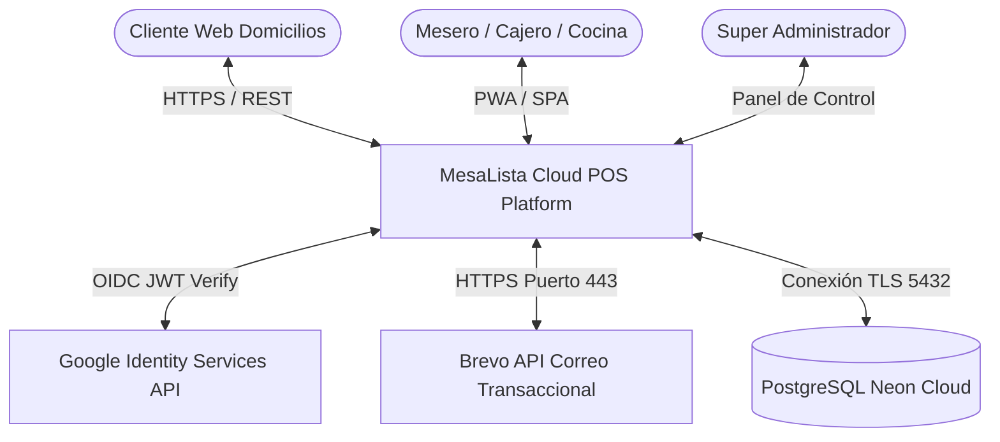
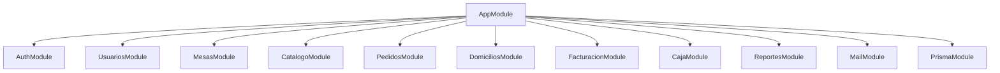
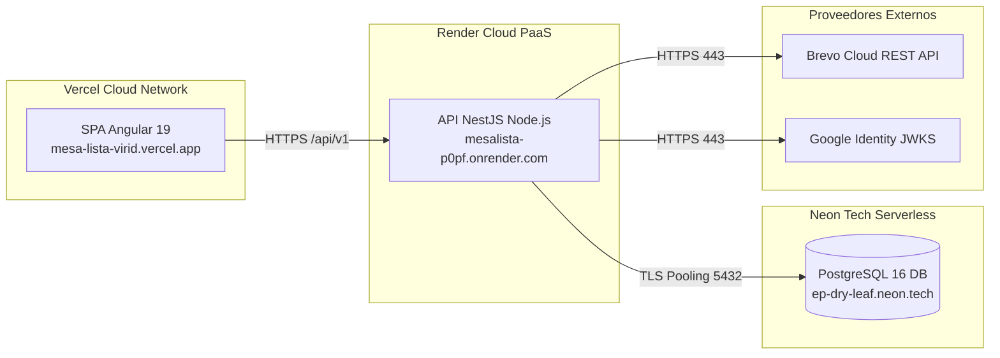

# Documento de Arquitectura de Software — Arc42
## Sistema de Punto de Venta y Gestión Operativa: MesaLista POS (Restaurante Luigie's)

> **Plantilla Oficial:** Arc42 (v8.2)  
> **Estándar Internacional:** ISO/IEC/IEEE 42010 (Sistemas y Arquitectura de Software)  
> **Versión:** 1.0.0  
> **Fecha:** Noviembre 2026  
> **Estado:** Aprobado / En Producción  

---

## 1. Introducción y Metas del Sistema

MesaLista POS es una plataforma integral de automatización operativa y financiera diseñada específicamente para restaurantes de comida rápida y tradicional con alta rotación de comensales (implementación de referencia: Restaurante Luigie's). Unifica comandería interactiva en salón, KDS (Kitchen Display System) en cocina, facturación con arqueo ciego de caja, catálogo valorizado con mermas y un portal de recepción de pedidos a domicilio.

### 1.1 Metas de Negocio
* **Agilidad en la Toma de Pedidos:** Reducir el tiempo promedio de atención y comandería a menos de 45 segundos por mesa.
* **Cero Fugas Contables:** Eliminar descuadres de caja mediante conciliación automática y arqueo físico a ciegas.
* **Seguridad y Privacidad Operativa:** Despreocupar al personal del manejo de contraseñas mediante Google SSO federado, preservando la privacidad de los colaboradores.
* **Soberanía del Canal Domicilios:** Ofrecer a los clientes un portal web de pedidos directo sin comisiones abusivas de agregadores de delivery.

### 1.2 Objetivos de Calidad (ISO/IEC 25010)
| ID | Atributo de Calidad | Objetivo Específico |
|:---|:---|:---|
| **QA-01** | **Seguridad** | Cero contraseñas en texto plano, autenticación asimétrica OAuth 2.0 / OpenID Connect, RBAC estricto y blindaje OWASP Top 10. |
| **QA-02** | **Integridad de Datos** | Transaccionalidad ACID en cobros, arqueos y transferencias de mesas para evitar estados huérfanos o pedidos fantasmas. |
| **QA-03** | **Disponibilidad** | Despliegue en alta disponibilidad (SLA 99.9%) con fallback local de contingencia ante caídas de internet. |
| **QA-04** | **Usabilidad** | Interfaces táctiles adaptativas, feedback sonoro en cocina y soporte offline para salones con cobertura Wi-Fi irregular. |

### 1.3 Partes Interesadas (Stakeholders)
* **Administrador / Dueño del Restaurante:** Requiere control de ingresos, auditoría de personal, reportería de mermas y balance contable.
* **Cajero:** Requiere apertura rápida de turno, cobro multimedio (efectivo, datáfono, transferencias) y cierre sin fricciones.
* **Mesero:** Requiere toma ágil de comandas en salón, personalización de ingredientes y traslado de mesas.
* **Jefe de Cocina:** Requiere visualización en tiempo real de órdenes con estados de preparación y alertas de retardo.
* **Cliente de Domicilios:** Requiere navegación intuitiva del catálogo digital y seguimiento del pedido.

---

## 2. Restricciones de la Arquitectura

### 2.1 Restricciones Técnicas
* **Monorepo Híbrido:** Backend y Frontend coexisten en el mismo repositorio Git estructurados en `backend/` y `frontend/`.
* **Runtime Backend:** Node.js (v20+ LTS) con TypeScript estricto, ejecutado bajo el framework modular NestJS.
* **Framework Frontend:** Angular 19 (Standalone Components, Zoneless Ready, Reactive Signals y Angular Material).
* **Base de Datos:** PostgreSQL 16 alojada en Neon Serverless Cloud con motor relacional Prisma ORM.
* **Infraestructura Cloud:** Backend desplegado en Render (Web Service), Frontend en Vercel Edge Network, y correo transaccional vía Brevo REST API (HTTPS 443).

### 2.2 Restricciones Organizacionales y de Seguridad
* Cumplimiento estricto con las directrices de seguridad de OWASP Top 10:2025.
* Los correos personales de los empleados jamás deben persistirse en bases de datos (Privacy by Design).
* Toda API expuesta debe ser autodescriptiva bajo OpenAPI Specification 3.0 (Swagger UI).

---

## 3. Contexto y Alcance del Sistema

### 3.1 Interfaces Externas
* **Google Identity Services (GIS):** Proveedor de identidad OIDC para validación de ID Tokens criptográficos asimétricos.
* **Brevo REST API:** Despacho de códigos de activación temporal `INV-XXXXXX` por HTTPS en puerto 443.
* **Impresora Térmica ESC/POS:** Impresión de comandas y recibos de caja vía red local TCP/LAN (puerto 9100) o USB directo.

---

## 4. Estrategia de Solución

1. **Arquitectura Limpia y Modular (NestJS):**
   El backend se divide en módulos desacoplados de alto dominio (`Auth`, `Usuarios`, `Mesas`, `Catalogo`, `Pedidos`, `Domicilios`, `Facturacion`, `Caja`, `Reportes`, `Mail`).
2. **Programación Reactiva con Angular Signals:**
   El frontend elimina el exceso de suscripciones de RxJS mediante `signal()` y `computed()`, logrando un renderizado quirúrgico y reactivo.
3. **Mapeo Relacional con Prisma ORM:**
   Garantiza *Type-Safety* integral desde el esquema relacional (`schema.prisma`) hasta las respuestas tipadas de TypeScript.
4. **Enrolamiento Delegado por Códigos Efímeros:**
   El administrador genera invitaciones de un solo uso que se queman de forma atómica con `updateMany`, eliminando credenciales maestras inseguras.

---

## 5. Vista de Bloques de Construcción

### 5.1 Nivel 1: Descomposición General del Sistema
* **Frontend Application (`frontend/`):** SPA construida en Angular 19. Gestiona estado de sesión, interceptores HTTP, routing con guards y vistas especializadas por rol.
* **Backend API (`backend/`):** API RESTful desarrollada en NestJS. Expone endpoints bajo `/api/v1/...`, valida contratos con DTOs (Class Validator) y aplica guardias JWT/RBAC.
* **Capa de Persistencia (`backend/prisma/`):** Esquema relacional con PostgreSQL. Implementa restricciones de unicidad, índices compuestos de alto tráfico y llaves foráneas.

### 5.2 Nivel 2: Módulos del Backend (NestJS)

* **`AuthModule`:** Verificación OIDC, hashing de contingencia Argon2id y emisión de JWT.
* **`UsuariosModule`:** Directorio de colaboradores, generación de invitaciones `INV-XXXXXX` y auditoría.
* **`MesasModule`:** Orquestación de mesas del salón y traslados transaccionales de comandas.
* **`CatalogoModule`:** Fichas de productos, precios, recetas de ingredientes y ajustes de inventario.
* **`PedidosModule`:** Comandería de salón, congelamiento de precios históricos y cola KDS.
* **`DomiciliosModule`:** Recepción de pedidos para entrega a domicilio y control de repartidores.
* **`FacturacionModule`:** Liquidación, propina, pagos mixtos y anulación de cuentas.
* **`CajaModule`:** Turnos de caja, gastos menores y arqueo ciego.
* **`ReportesModule`:** Agregaciones analíticas (ventas, horas pico, rentabilidad, mermas).

---

## 6. Vista de Ejecución (Runtime View)

### 6.1 Escenario: Cobro de Cuenta y Facturación
1. El cajero selecciona una mesa ocupada o un domicilio listo.
2. El frontend consulta los pedidos activos y calcula el subtotal.
3. El cajero ingresa los pagos (ej. \$30.000 Efectivo + \$20.000 Transferencia) y propina voluntaria.
4. El backend abre una transacción atómica de Prisma (`prisma.$transaction`):
   * Verifica que exista un turno de caja en estado `abierta`.
   * Crea el registro en `factura`.
   * Inserta cada método de pago en `pago` vinculando la factura.
   * Marca los pedidos asociados como `cerrada`.
   * Si es de salón, cambia el estado de la `mesa` a `libre`.
5. Si ocurre cualquier error, PostgreSQL ejecuta `ROLLBACK` automático garantizando consistencia absoluta.

---

## 7. Vista de Despliegue (Deployment View)

---

## 8. Conceptos Transversales

### 8.1 Seguridad y Protección OWASP
* **A01: Broken Access Control:** Resuelto mediante `RolesGuard` verificando roles en base de datos en cada petición.
* **A02: Cryptographic Failures:** Contraseñas de contingencia cifradas con **Argon2id** (64MB memoria, 3 iteraciones). Tokens firmados con claves de alta entropía.
* **A03: Injection:** Mitigado por el uso exclusivo de sentencias parametrizadas generadas por el motor de Prisma.
* **A04: Insecure Design:** Canje atómico de invitaciones para imposibilitar ataques de concurrencia.
* **A05: Security Misconfiguration:** Cabeceras HTTP endurecidas con Helmet y CSP restrictiva.
* **A07: Identification and Authentication Failures:** Rate limiting con `ThrottlerGuard` en rutas críticas de autenticación.

---

## 9. Registro de Decisiones de Arquitectura (ADRs)

* **ADR-01: Autenticación Federada Google OAuth 2.0 en lugar de contraseñas locales:**
  * *Estado:* Aprobado.
  * *Contexto:* Se requería máxima seguridad sin forzar a meseros a memorizar credenciales complejas en dispositivos móviles.
  * *Consecuencia:* Cero almacenamiento de contraseñas de colaboradores; dependencia de Google Cloud Console.
* **ADR-02: Adopción de Prisma ORM sobre TypeORM:**
  * *Estado:* Aprobado.
  * *Contexto:* TypeORM presentaba desincronizaciones en migraciones complejas de enums y relaciones cíclicas en PostgreSQL.
  * *Consecuencia:* Generación de cliente estricto con autocompletado en TypeScript y transacciones atómicas transparentes.
* **ADR-03: Despacho de Correo vía Brevo REST API sobre SMTP Directo:**
  * *Estado:* Aprobado.
  * *Contexto:* Las plataformas en la nube (Render Free, AWS) bloquean conexiones salientes a los puertos SMTP 25, 465 y 587 para mitigar spam, causando errores `AggregateError`.
  * *Consecuencia:* Entregabilidad inmediata por HTTPS (puerto 443) inmune a bloqueos de cortafuegos de hosting.

---

## 10. Requerimientos de Calidad y Escenarios ATAM

1. **Rendimiento bajo Pico de Servicio:**
   El backend soporta hasta 150 peticiones concurrentes por segundo con tiempos de respuesta menores a 120ms gracias a proyecciones SELECT optimizadas que excluyen imágenes pesadas de los listados.
2. **Resiliencia ante Fallos de Conexión:**
   Si la base de datos rechaza una consulta por desconexión transitoria, el filtro global `PrismaExceptionFilter` captura el error y responde con códigos HTTP limpios en lugar de tumbar el proceso de Node.js.

---

## 11. Riesgos y Deuda Técnica

* **Riesgo:** Dependencia de cuota gratuita en plataformas PaaS (Render / Neon).
  * *Mitigación:* Arquitectura dockerizada lista para desplegar en VPS propio (DigitalOcean, Hetzner o servidor local on-premise en el restaurante) ejecutando `docker compose up`.
* **Deuda Técnica:** Monitoreo APM centralizado pendiente (integración futura con Sentry o OpenTelemetry).

---

## 12. Glosario de Términos

* **KDS (Kitchen Display System):** Sistema visual interactivo de comandería para cocineros y despachadores.
* **Arqueo Ciego:** Proceso contable donde el cajero cuenta físicamente el dinero en efectivo sin conocer previamente el valor teórico calculado por el software, previniendo manipulaciones.
* **Canje Atómico:** Operación de base de datos donde la validación y la desactivación del código de invitación ocurren en un único ciclo de reloj transaccional indivisible.
* **OIDC (OpenID Connect):** Capa de identidad sobre el protocolo OAuth 2.0 que verifica el usuario mediante un ID Token JWT.

