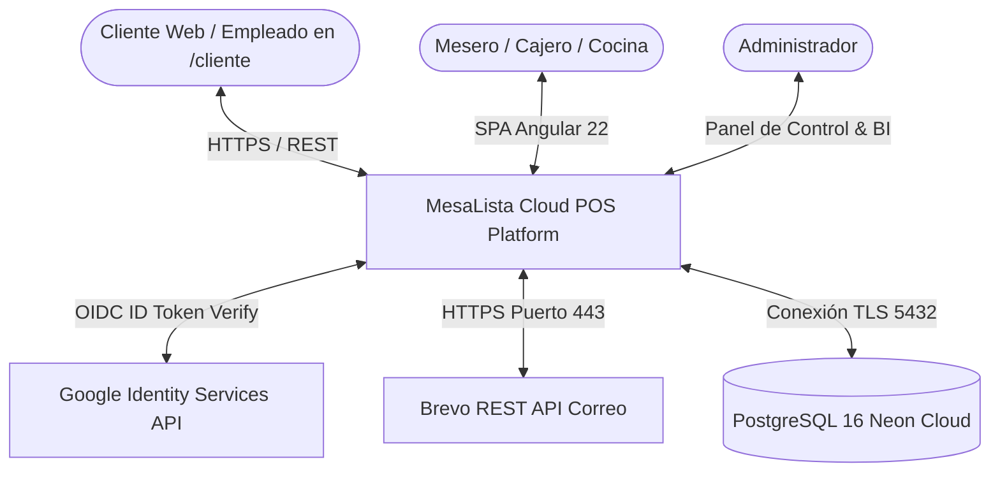
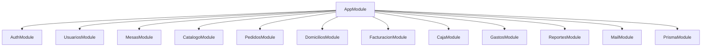
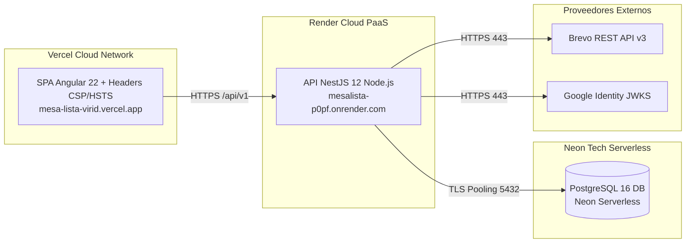

# Documento de Arquitectura de Software — Arc42
## Sistema de Punto de Venta y Gestión Operativa: MesaLista POS (Restaurante Luigie's)

> **Plantilla Oficial:** Arc42 (v8.2)  
> **Estándar Internacional:** ISO/IEC/IEEE 42010 (Sistemas y Arquitectura de Software)  
> **Versión:** 1.1.0 (Entrega Final)  
> **Fecha:** Noviembre 2026  
> **Estado:** Aprobado / Listo para Entrega

---

## 1. Introducción y Metas del Sistema

MesaLista POS es una plataforma integral de automatización operativa y financiera diseñada para restaurantes de comida rápida y tradicional con alta rotación de comensales (implementación piloto: **Restaurante Nocturno Luigie's**, Popayán). Unifica comandería interactiva en salón, KDS (*Kitchen Display System*) en cocina, facturación con arqueo ciego de caja, catálogo valorizado con control de stock y mermas, reportes BI y un portal web de domicilios.

### 1.1 Metas de Negocio
* **Agilidad en la Toma de Pedidos:** Reducir el tiempo promedio de atención y comandería en salón a menos de 45 segundos por mesa.
* **Cero Fugas Contables:** Eliminar descuadres de caja mediante conciliación automática, bloqueo transaccional anti-duplicados y arqueo físico ciego.
* **Seguridad y Privacidad Operativa:** Eliminar el manejo de contraseñas locales mediante Google SSO federado (OIDC) y enrolamiento por códigos efímeros sin persistir correos personales de los empleados.
* **Soberanía del Canal Domicilios:** Ofrecer a clientes y colaboradores un portal web propio (`/cliente`) sin comisiones de terceros.

### 1.2 Objetivos de Calidad (ISO/IEC 25010)
| ID | Atributo de Calidad | Objetivo Específico |
|:---|:---|:---|
| **QA-01** | **Seguridad** | Cero contraseñas locales, autenticación asimétrica Google OAuth 2.0 / OIDC, RBAC estricto, anti-IDOR, CORS por hostname, rate limiting y blindaje OWASP Top 10:2025. |
| **QA-02** | **Integridad Contable y de Datos** | Transaccionalidad ACID con `pg_advisory_xact_lock` y actualizaciones condicionales atómicas (`updateMany`) en stock, consecutivos, cobros y cierres de caja. |
| **QA-03** | **Disponibilidad y Resiliencia** | Despliegue cloud redundante (Vercel + Render + Neon) con contenedorización Docker para contingencia on-premise y manejo seguro de excepciones Prisma. |
| **QA-04** | **Usabilidad** | Interfaces responsivas con Angular Material y Signals, navegación rápida por rol y acceso directo al portal cliente desde `/login`. |

### 1.3 Partes Interesadas (Stakeholders)
* **Administrador / Dueño del Restaurante:** Gestión de colaboradores e invitaciones, catálogo valorizado, ajustes de inventario, auditoría y reportes BI.
* **Cajero:** Apertura de turno, cobro multimedio (efectivo, datáfono/tarjeta, transferencia/QR), egresos menores, anulaciones auditadas y cierre ciego.
* **Mesero:** Toma ágil de comandas en salón, personalización de ingredientes, traslado de mesas y cobro en salón.
* **Personal de Cocina:** Visualización en tiempo real de comandas en el panel KDS y gestión de estados de preparación.
* **Cliente (y colaboradores en modo cliente):** Navegación de la carta digital, carrito de compras y seguimiento en vivo de sus pedidos a domicilio.

---

## 2. Restricciones de la Arquitectura

### 2.1 Restricciones Técnicas
* **Monorepo Híbrido:** Backend y Frontend coexisten en el mismo repositorio Git bajo `backend/` y `frontend/`.
* **Runtime Backend:** Node.js (v20/v24 LTS) con TypeScript 6.0 en modo estricto (`strict: true`), ejecutado sobre **NestJS 12**.
* **Framework Frontend:** **Angular 22** (Standalone Components, Signals, Angular Material 22, `strictTemplates: true`), probado con **Vitest 4**.
* **Base de Datos:** PostgreSQL 16 alojada en Neon Serverless Cloud con motor relacional **Prisma ORM 6.19**.
* **Infraestructura Cloud:** Backend en Render (Web Service), Frontend en Vercel Edge Network (con cabeceras CSP/HSTS en `vercel.json`) y correo transaccional vía Brevo REST API (HTTPS 443) con respaldo Resend/SMTP.

### 2.2 Restricciones Organizacionales y de Seguridad
* Cumplimiento verificado con **OWASP Top 10:2025** y pruebas automatizadas de seguridad y fuzzing (`Jest 30` + `fast-check`).
* **Privacidad por diseño (Privacy by Design):** Los correos personales de los empleados operativos (`administrador`, `cajero`, `mesero`, `cocina`) se usan únicamente de forma efímera para enviar el código de activación y **no se persisten** en la tabla `usuario` (`email: null`; vinculación por `googleId`). Las cuentas con rol `cliente` sí conservan su `email` para trazabilidad de pedidos a domicilio.
* Toda API expuesta está documentada bajo **OpenAPI Specification 3.0** (Swagger UI en `/api/docs`).

---

## 3. Contexto y Alcance del Sistema

### 3.1 Interfaces Externas
* **Google Identity Services (GIS):** Proveedor de identidad OIDC para verificación asimétrica de ID Tokens mediante `google-auth-library`.
* **Brevo REST API (con respaldo Resend/SMTP):** Despacho de códigos de activación temporal `INV-XXXXXXXX` (8 caracteres Base32 Crockford, 48 h de vigencia) por HTTPS en puerto 443 con timeout controlado de 8 s.
* **Impresora Térmica ESC/POS:** Impresión de comandas y recibos de caja vía red local TCP/LAN o interfaz configurada en `PRINTER_INTERFACE`.

---

## 4. Estrategia de Solución

1. **Arquitectura Modular (NestJS 12):**
   Separación por dominios de negocio (`Auth`, `Usuarios`, `Mesas`, `Catalogo`, `Pedidos`, `Domicilios`, `Facturacion`, `Caja`, `Gastos`, `Reportes`, `Mail`, `Prisma`) más utilidades transversales centralizadas (`contabilidad.util.ts`, `date-range.util.ts`).
2. **Estado Reactivo con Angular Signals:**
   Uso de `signal()` y `computed()` para minimizar suscripciones manuales, con guards diferenciados por rol y acceso compartido de empleados al portal `/cliente`.
3. **Concurrencia Segura en PostgreSQL:**
   Bloqueos consultivos transaccionales (`pg_advisory_xact_lock`) para serializar consecutivos diarios de pedidos (`730101`), facturación (`730201`) y apertura/cierre de caja (`730301`), combinados con `updateMany` condicional para impedir stock negativo, doble facturación o doble canje de invitación.
4. **Enrolamiento Delegado por Códigos Efímeros:**
   Códigos `INV-XXXXXXXX` generados con `crypto.randomInt` (~35 bits de entropía), vigencia de 48 horas, validación de cuenta activa previa al canje y consumo atómico de un solo uso.

---

## 5. Vista de Bloques de Construcción

### 5.1 Nivel 1: Descomposición General
* **Frontend Application (`frontend/`):** SPA en Angular 22. Gestiona sesión JWT, interceptor HTTP, guards de rol y portal cliente, vistas táctiles de salón/cocina/caja/domicilios y exportación de reportes (CSV/Excel/PDF).
* **Backend API (`backend/`):** API RESTful en NestJS 12 bajo `/api/v1/...`. Aplica `ValidationPipe` estricto (`whitelist`, `forbidNonWhitelisted`), `Helmet`, `ThrottlerGuard`, `JwtAuthGuard` (con detección opcional de usuario en rutas `@Public()`), `RolesGuard` y `PrismaExceptionFilter`.
* **Capa de Persistencia (`backend/prisma/`):** Esquema relacional en PostgreSQL 16 con integridad referencial, restricciones de unicidad e índices de consulta.

### 5.2 Nivel 2: Módulos del Backend (NestJS)

* **`AuthModule`:** Verificación OIDC con `google-auth-library`, emisión de JWT Bearer, rate-limit dedicado (`15 req/min`) y consulta/edición de perfil.
* **`UsuariosModule`:** Directorio de personal, generación/reenvío limitado (`10 req/min`) de códigos `INV-XXXXXXXX` sin almacenar correo personal de empleados, protección contra auto-desactivación y preservación del último `administrador` activo.
* **`MesasModule`:** Mapa del salón (`libre`/`ocupada`), bloqueo de liberación con comandas sin facturar y traslado atómico de cuentas validando origen/destino.
* **`CatalogoModule`:** Carta pública (ocultando el campo `costo` a público general y roles no administrativos), creación/edición protegida y ajustes de inventario trazables.
* **`PedidosModule`:** Comandería de salón y cola KDS con congelamiento histórico de precios, descuento atómico condicional de stock y máquinas de estado transaccionales.
* **`DomiciliosModule`:** Portal público de disponibilidad y domicilios, separación de pedidos personales de empleados con `[PORTAL_CLIENTE]`, control anti-IDOR (`cliente` y `cocina`) y gestión de etapas de despacho.
* **`FacturacionModule`:** Cobro atómico con pagos mixtos y propina, prevención de re-facturación (`409 Conflict`), restricción de cambio de precios unitarios a `administrador`, filtro por `estado` y anulación auditada que libera mesas vacías.
* **`CajaModule` y `GastosModule`:** Turnos de caja con lock de concurrencia, registro de gastos menores por categoría y medio normalizado, arqueo ciego y conciliación.
* **`ReportesModule`:** Analítica BI acotada (máximo 366 días), `balance_operativo`, filtros por categoría/canal, turnos solapados por fecha y detalle de anulaciones.

---

## 6. Vista de Ejecución (Runtime View)

### 6.1 Escenario: Cobro Atómico de Cuenta y Facturación
1. El cajero (o mesero) selecciona una mesa ocupada o un pedido a domicilio listo para cobro.
2. El frontend calcula el subtotal y captura los pagos (simples o mixtos) más la propina voluntaria.
3. El backend inicia una transacción `prisma.$transaction`:
   * Adquiere `pg_advisory_xact_lock(730201)` para serializar la operación de facturación.
   * Verifica que exista un turno de `caja` en estado `abierta` y que ningún pedido ya tenga `id_factura`.
   * Normaliza los medios de pago con `normalizarMedioPago`, calcula `valor`, `propina` y `valor_total` redondeados a 2 decimales, y ajusta el excedente de vueltos en efectivo.
   * Crea la `factura` y los registros en `pago`.
   * Ejecuta `tx.pedido.updateMany` condicionando `id_factura: null` y `estado: 'enviada'`, y verifica `count === idsPedidos.length` (si no coincide, aborta con `409 Conflict`).
   * Si es venta de salón sin más pedidos abiertos, actualiza la `mesa` a `libre`.
4. Ante cualquier fallo o colisión concurrente, PostgreSQL ejecuta `ROLLBACK` íntegro.

---

## 7. Vista de Despliegue (Deployment View)

---

## 8. Conceptos Transversales

### 8.1 Seguridad y Protección OWASP Top 10:2025
* **A01 – Broken Access Control:** `RolesGuard` con auditoría `[SECURITY_AUDIT]`, anti-IDOR en `DomiciliosService.obtenerPorId` para `cliente` y `cocina`, ocultamiento de `costo` en catálogo público, restricción de edición de `precio_unitario` y bloqueo de auto-desactivación / eliminación del último administrador.
* **A02 – Security Misconfiguration:** `Helmet` + CSP en backend, cabeceras defensivas en `frontend/vercel.json`, `trust proxy = 1`, CORS estricto por `URL.hostname` y validación de variables de entorno con Joi.
* **A03 – Software Supply Chain:** Árbol de dependencias auditado y limpio de paquetes obsoletos.
* **A04 – Cryptographic Failures:** Cero contraseñas almacenadas; códigos de invitación generados con `crypto.randomInt` (CSPRNG); tokens JWT firmados con secreto ≥ 32 caracteres y verificación asimétrica de Google ID Tokens.
* **A05 – Injection:** Consultas tipadas y parametrizadas con Prisma ORM, `ValidationPipe` global estricto, filtro anti-null-byte (`\0`), sanitización CRLF y dot-stuffing RFC 5321 en correo.
* **A06 – Insecure Design:** Bloqueos `pg_advisory_xact_lock`, `updateMany` condicional atómico, congelamiento de precios y validaciones contables centralizadas.
* **A07 – Authentication Failures:** Google OAuth 2.0 puro, rechazo de cuentas inactivas antes de quemar invitación y rate-limiting con `@nestjs/throttler` en `/auth/google` y `/usuarios/:id/enviar-codigo`.
* **A09 / A10 – Logging & Exception Handling:** Logs estructurados sin fuga de secretos ni códigos y `PrismaExceptionFilter` cubriendo errores conocidos, de validación, desconocidos y pánico de motor.

---

## 9. Registro de Decisiones de Arquitectura (ADRs)

* **ADR-01: Autenticación Federada Google OAuth 2.0 Exclusiva (Sin Contraseñas Locales):**
  * *Estado:* Aprobado e implementado.
  * *Contexto:* Eliminar riesgos de contraseñas débiles o compartidas entre personal rotativo y reducir fricción en pantallas táctiles.
  * *Consecuencia:* Cero hashes de contraseñas en BD; acceso corporativo gobernado por Google OAuth + códigos efímeros `INV-XXXXXXXX`.
* **ADR-02: Privacidad Diferenciada de Correos (Empleados vs. Clientes):**
  * *Estado:* Aprobado e implementado.
  * *Contexto:* Los empleados se vinculan por `googleId` sin requerir conservar su correo personal, mientras que el módulo de clientes/domicilios requiere trazabilidad de contacto.
  * *Consecuencia:* `usuario.email` permanece `null` para colaboradores operativos y se conserva únicamente para cuentas `cliente` (y en comprobantes de pedidos/facturas cuando aplica).
* **ADR-03: Adopción de Prisma ORM 6 + Advisory Locks de PostgreSQL:**
  * *Estado:* Aprobado e implementado.
  * *Consecuencia:* Tipado de extremo a extremo y protección real contra condiciones de carrera sin requerir infraestructura adicional como Redis.
* **ADR-04: Despacho de Correo vía Brevo REST API (HTTPS 443) sobre SMTP Directo:**
  * *Estado:* Aprobado e implementado.
  * *Contexto:* Render Free bloquea puertos SMTP salientes (25/465/587).
  * *Consecuencia:* Entregabilidad confiable por HTTPS con timeout de 8 s y respaldo SMTP endurecido para entornos locales/VPS.

---

## 10. Requerimientos de Calidad y Escenarios ATAM

1. **Consistencia Contable bajo Concurrencia:**
   Dos peticiones simultáneas compitiendo por la última unidad de stock, por el consecutivo diario, por facturar la misma mesa o por abrir caja se serializan en PostgreSQL: exactamente una completa la operación y la otra recibe un rechazo limpio (`400`/`409`) sin corrupción de datos.
2. **Resiliencia ante Entradas Hostiles y Fallos de Motor:**
   Payloads de desbordamiento numérico (`P2020`), cadenas largas (`P2000`), bytes nulos (`\0`) o fallos inesperados del motor (`PrismaClientRustPanicError` / `PrismaClientUnknownRequestError`) son interceptados por `PrismaExceptionFilter` sin exponer trazas internas ni derribar el proceso.

---

## 11. Riesgos y Deuda Técnica Conocida

* **Cuotas Free Tier (Render / Neon):** Render Free hiberna la instancia tras inactividad (*cold start* de ~30–50 s en la primera petición del día).
  * *Mitigación:* Arquitectura lista con `docker-compose.yml` para migrar a VPS o servidor local del restaurante sin cambios de código.
* **Catálogo de repartidores y estado de pausa de domicilios en memoria:** Se mantuvieron en memoria del proceso para no requerir una migración de esquema Prisma antes de la entrega.
  * *Evolución planificada:* Persistir ambos estados en tablas dedicadas de PostgreSQL en la siguiente iteración (requiere migración Prisma).
* **Monitoreo APM centralizado:** Pendiente integración futura con Sentry u OpenTelemetry en producción.

---

## 12. Glosario de Términos

* **KDS (*Kitchen Display System*):** Pantalla interactiva de comandería en cocina para gestión de tiempos y estados de preparación.
* **Arqueo Ciego:** Cierre de caja en el que el cajero registra el efectivo contado físicamente antes de conocer el saldo teórico esperado por el sistema.
* **Canje Atómico:** Validación y consumo indivisible del código de invitación `INV-XXXXXXXX` mediante `updateMany` condicional.
* **Advisory Lock (`pg_advisory_xact_lock`):** Bloqueo consultivo a nivel de transacción en PostgreSQL liberado automáticamente al finalizar el `COMMIT` o `ROLLBACK`.
* **OIDC (*OpenID Connect*):** Capa de identidad sobre OAuth 2.0 basada en ID Tokens JWT firmados asimétricamente por Google.
