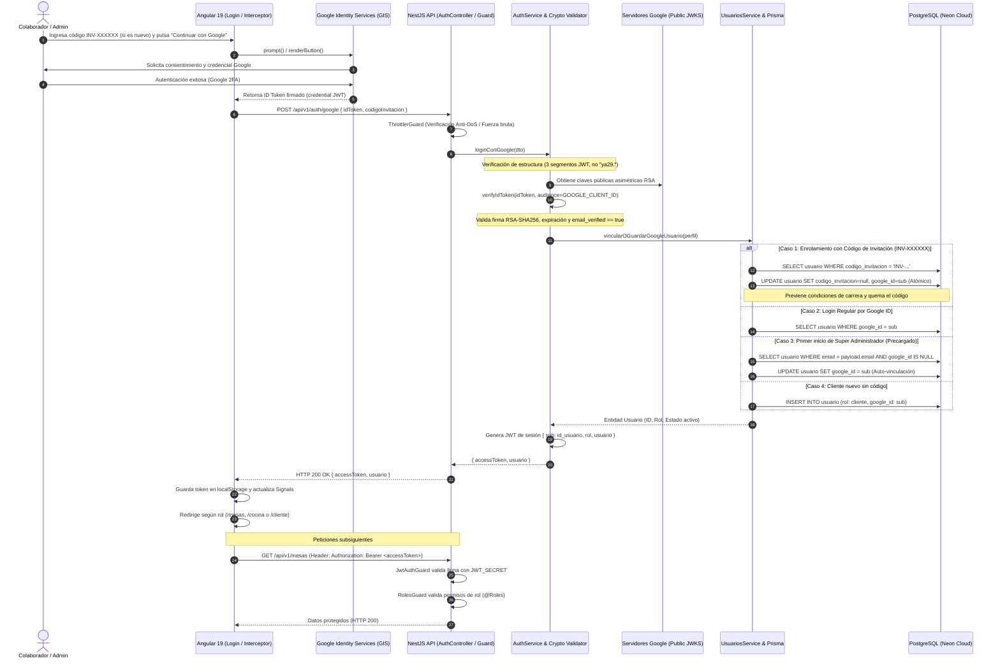

# Guía Técnica para la Sustentación Oral: Arquitectura de Autenticación con Google OAuth 2.0 y RBAC

> **Documento de Defensa de Arquitectura y Seguridad**  
> **Sistema:** MesaLista Cloud POS (Restaurante Luigie's)  
> **Estándar:** OpenID Connect (OIDC) / OAuth 2.0 / RFC 7519 (JWT) / NIST SP 800-63B  
> **Fecha:** Noviembre 2026  
> **Audiencia:** Evaluadores de proyecto, comités de arquitectura de software y auditores de seguridad.

---

## 1. Resumen Ejecutivo y Decisión de Diseño

El sistema MesaLista POS implementa un modelo de autenticación federada basado en **Google Identity Services (GIS)** bajo el protocolo **OpenID Connect (OIDC)**, complementado con un esquema de **tokens de enrolamiento temporal (`INV-XXXXXX`)** y **JSON Web Tokens (JWT) asimétricos y de corta vigencia** para la sesión interna.

### ¿Por qué se tomó esta decisión de arquitectura?
1. **Eliminación de la Superficie de Ataque por Credenciales:**
   El almacenamiento de contraseñas locales para todo el personal operativo (meseros, cajeros, cocina) introduce vulnerabilidades de *Credential Stuffing*, contraseñas débiles en turnos rápidos y filtraciones de base de datos. Delegar la verificación en Google garantiza autenticación de doble factor (2FA) nativa sin costo de implementación.
2. **Privacidad de los Colaboradores (Privacy by Design):**
   Los correos personales de los colaboradores se utilizan de forma **efímera** para la entrega del código de invitación y **NUNCA se persisten en la base de datos**. El identificador único es el `sub` criptográfico emitido por Google (`google_id`).
3. **Flujo de Contingencia y Alta Disponibilidad (Offline Fallback):**
   Para contingencias donde se caiga la conexión WAN/Internet del restaurante, el backend conserva soporte de autenticación local de contingencia (`/auth/login`) protegido por hashing **Argon2id** (ganador de la *Password Hashing Competition*) y limitación de tasa agresiva (**Rate Limiting / Throttler**).

---

## 2. Diagrama de Secuencia de Extremo a Extremo (End-to-End)



---

## 3. Recorrido Técnico Paso a Paso (Archivo por Archivo)

### Paso 1: Inicialización del Cliente y Captura de Credenciales
* **Archivo:** [`frontend/src/app/features/auth/login/login.ts`](file:///d:/UNICAUCA/Pro%20II/Mesa%20Lista/frontend/src/app/features/auth/login/login.ts)
* **Mecanismo:**
  * En `ngAfterViewInit()`, invoca `initGoogleAuth()`, el cual carga de forma asíncrona la librería oficial de Google (`google.accounts.id.initialize`).
  * Asocia el Client ID configurado en `environment.googleClientId`.
  * Define dos modos de operación en un signal reactivo (`modo = signal<'acceso' | 'registro'>`):
    * `acceso`: Ingreso de administradores y personal ya enrolado con 1 clic.
    * `registro`: Campo para digitar el código temporal (`INV-XXXXXX`).
  * Cuando el usuario completa la ventana de Google, GIS dispara el callback `handleGoogleResponse(response)`.
  * La credencial recibida (`response.credential`) es una cadena JWT firmada asimétricamente por Google con RSA-256.

### Paso 2: Transporte HTTP y Gestión Reactiva de Estado en Frontend
* **Archivo:** [`frontend/src/app/core/services/auth/auth.service.ts`](file:///d:/UNICAUCA/Pro%20II/Mesa%20Lista/frontend/src/app/core/services/auth/auth.service.ts)
* **Mecanismo:**
  * El método `loginGoogle(idToken, codigoInvitacion)` emite una petición `POST /api/v1/auth/google`.
  * Al recibir la respuesta exitosa, desempaca `{ accessToken, usuario }` y ejecuta `guardarSesion()`:
    * Almacena el `accessToken` en `localStorage` bajo `mesalista_access_token`.
    * Actualiza los Angular Signals: `token`, `currentUser`, `isAuthenticated` y `userRole`.
* **Archivo:** [`frontend/src/app/core/interceptors/jwt.interceptor.ts`](file:///d:/UNICAUCA/Pro%20II/Mesa%20Lista/frontend/src/app/core/interceptors/jwt.interceptor.ts)
  * Intercepta cada llamada HTTP hacia la API e inyecta la cabecera:
    ```http
    Authorization: Bearer <accessToken>
    ```

### Paso 3: Entrada y Rate Limiting en el Backend
* **Archivo:** [`backend/src/modules/auth/auth.controller.ts`](file:///d:/UNICAUCA/Pro%20II/Mesa%20Lista/backend/src/modules/auth/auth.controller.ts)
* **Mecanismo:**
  * Endpoint `@Post('google')` protegido por `ThrottlerGuard` para mitigar ataques de denegación de servicio (DoS) o prueba de fuerza bruta de códigos.
  * Valida la estructura mediante [`GoogleLoginDto`](file:///d:/UNICAUCA/Pro%20II/Mesa%20Lista/backend/src/modules/auth/dto/google-login.dto.ts).

### Paso 4: Validación Criptográfica del Token de Google
* **Archivo:** [`backend/src/modules/auth/auth.service.ts`](file:///d:/UNICAUCA/Pro%20II/Mesa%20Lista/backend/src/modules/auth/auth.service.ts)
* **Mecanismo de Blindaje Criptográfico:**
  1. **Filtro de tipo de token:** Detecta y rechaza tokens `ya29.` (Access Tokens de Google OAuth2). La verificación criptográfica exige estrictamente un `id_token` (JWT).
  2. **Validación de segmentos:** Comprueba que la cadena tenga exactamente 3 partes divididas por puntos (`header.payload.signature`).
  3. **Verificación asimétrica oficial con Google:**
     ```typescript
     ticket = await this.googleClient.verifyIdToken({
       idToken: tokenLimpio,
       audience: clientIds,
       maxExpiry: 86400,
     });
     ```
     La librería `google-auth-library` descarga las claves públicas desde `https://www.googleapis.com/oauth2/v3/certs`, verifica la firma digital RSA-SHA256, comprueba que el token no haya expirado y que la audiencia (`aud`) coincida exactamente con nuestro `GOOGLE_CLIENT_ID`.
  4. **Comprobación de correo verificado:** Exige que `payload.email_verified === true`.

### Paso 5: Resolución de Identidad y Canje Atómico en Base de Datos
* **Archivo:** [`backend/src/modules/usuarios/usuarios.service.ts`](file:///d:/UNICAUCA/Pro%20II/Mesa%20Lista/backend/src/modules/usuarios/usuarios.service.ts)
* **Método clave:** `vincularOGuardarGoogleUsuario(perfil)`
* **Reglas de negocio y seguridad aplicadas:**
  * **Canje Atómico de Códigos (Anti-Condición de Carrera):**
    Utiliza una sentencia condicional `prisma.usuario.updateMany({ where: { id_usuario, codigoInvitacion } })`. Si dos peticiones simultáneas intentan canjear el mismo código, una sola logra actualizar la fila (`count === 1`), mientras que la segunda es rechazada con `401 Unauthorized`.
  * **Limpieza de cuentas cliente temporales (Anti-Colisión P2002):**
    Si el empleado antes había probado la carta escaneando como cliente (creando un registro cliente previo con su email), el sistema libera esos datos de la cuenta temporal para que no choquen con la restricción única de PostgreSQL.
  * **Protección contra Secuestro de Cuentas (Anti-Account Takeover):**
    Si un usuario ya tiene un `googleId` enlazado y llega otra cuenta de Google distinta reclamando ese email, el sistema **bloquea la solicitud** arrojando `UnauthorizedException`.
  * **Auto-vinculación en primer inicio para Administradores:**
    Al encontrar una cuenta precreada (por consola SQL o seed) con `google_id: NULL` y correo coincidente verificado, enlaza el `googleId` automáticamente en ese instante.

### Paso 6: Emisión del Token de Sesión Propio y Control de Roles (RBAC)
* **Archivo:** [`backend/src/modules/auth/strategies/jwt.strategy.ts`](file:///d:/UNICAUCA/Pro%20II/Mesa%20Lista/backend/src/modules/auth/strategies/jwt.strategy.ts)
* **Archivo:** [`backend/src/common/guards/roles.guard.ts`](file:///d:/UNICAUCA/Pro%20II/Mesa%20Lista/backend/src/common/guards/roles.guard.ts)
* **Mecanismo:**
  * El backend emite un JWT firmado internamente con `JWT_SECRET` (mínimo 32 caracteres seguros).
  * En cada petición posterior, `JwtAuthGuard` valida el token y monta el usuario en `req.user`.
  * `RolesGuard` inspecciona el decorador `@Roles(...)` del endpoint y compara con `req.user.rol` (ej. solo `administrador` puede crear usuarios o ajustar inventario).

---

## 4. Banco de Preguntas y Respuestas para la Sustentación Oral

### P1: "¿Por qué no usan simplemente el token de Google para autorizar todas las peticiones a la API?"
> **Respuesta:** "Porque viola la separación de responsabilidades y genera latencia innecesaria. El ID Token de Google es un token de **autenticación de identidad de terceros**; no contiene los roles de negocio de nuestro restaurante (`cajero`, `mesero`, `cocina`). Validar el token de Google en cada una de las cientos de peticiones por minuto que hacen las terminales saturaría los límites de cuota de Google y aumentaría el tiempo de respuesta. Nuestro backend valida el token de Google una sola vez en el login y emite un JWT interno de MesaLista con los claims de rol pertinentes."

### P2: "¿Qué pasa si un atacante obtiene un ID Token válido emitido por Google para OTRA aplicación e intenta usarlo en MesaLista?"
> **Respuesta:** "El ataque fracasa de inmediato. En `auth.service.ts`, pasamos el parámetro `audience: GOOGLE_CLIENT_ID` al llamar a `verifyIdToken()`. La biblioteca de Google verifica criptográficamente que el claim `aud` del JWT coincida con el Client ID de MesaLista. Si el token fue generado para otra app web o móvil, la verificación RSA falla y arroja `UnauthorizedException`."

### P3: "¿Cómo evitan que dos empleados usen el mismo código de invitación al mismo tiempo?"
> **Respuesta:** "Implementamos canje atómico en la base de datos a nivel de motor PostgreSQL. La sentencia de quema del código no es una lectura seguida de una escritura, sino un `updateMany` condicional donde el código debe coincidir con el valor activo. Debido al aislamiento de transacciones de PostgreSQL (ACID), solo la primera transacción en llegar confirma la quema (`count === 1`); la segunda encuentra el código en `NULL` y es rechazada de inmediato."

### P4: "¿Por qué afirman que su sistema cumple con Privacidad por Diseño (Privacy by Design) en los colaboradores?"
> **Respuesta:** "Porque en la tabla `usuario` de PostgreSQL, la columna `email` para los colaboradores operativos permanece en `NULL`. El correo electrónico al que se envía la invitación solo viaja en memoria durante el despacho del mensaje por la API segura de Brevo y jamás se almacena en el disco ni en la base de datos. La identidad del colaborador queda asociada únicamente a su identificador criptográfico de Google (`google_id`), cumpliendo con el principio de minimización de datos del RGPD y la Ley de Protección de Datos Personales."

### P5: "¿Qué contingencia tienen si se cae la conexión a Internet en el restaurante?"
> **Respuesta:** "El sistema cuenta con un endpoint de alta disponibilidad y contingencia local (`POST /api/v1/auth/login`) protegido por rate limiting y contraseñas cifradas con Argon2id. Esto permite que, en caso de fallo prolongado del proveedor de internet, el restaurante pueda conmutar a la red LAN interna y continuar operando con credenciales maestras de respaldo."

